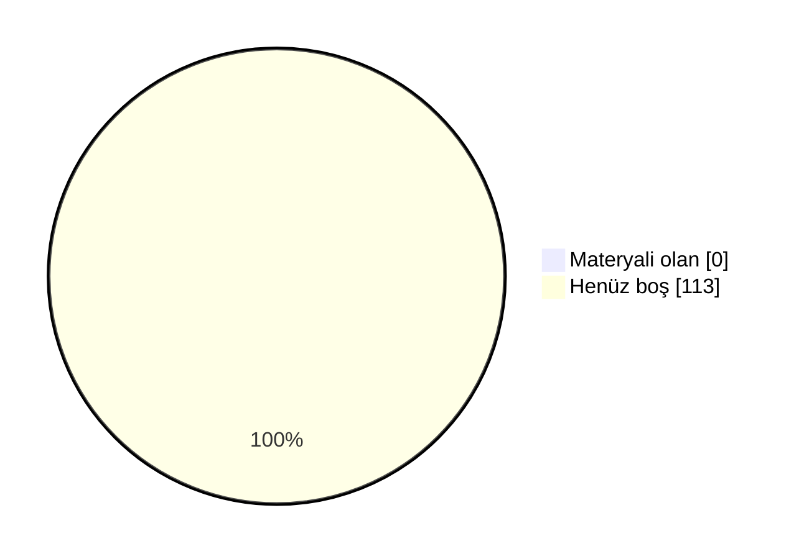

# 📖 Marmara Elektrik-Elektronik Mühendisliği Arşiv

Marmara Üniversitesi Teknoloji Fakültesi Elektrik-Elektronik Mühendisliği öğrencileri için düzenli, sürdürülebilir ve değer üreten bir akademik arşiv. Ders notları, ödev çözümleri, slaytlar, çıkmış sorular ve çalışma rehberleri tek bir yerde toplandı.

 ## 🗣️ Geri Bildirimde Bulunun

📬 Öğrenciler ve hocalar, derslerle ilgili hakaret içermeyen geri bildirimlerinizi aşağıdaki linkler aracılığıyla anonim olarak paylaşabilirsiniz.

- ℹ️ Geri bildirim formları yakında eklenecek.

## 🤝 Katkıda Bulunun

Elinde ders notu, slayt, çıkmış soru ya da ödev çözümü varsa arşive eklemek çok kolay:

- 📁 **GitHub kullanmıyorsan:** [Google Drive klasörümüze](https://drive.google.com/drive/folders/1KRobMRVHpJxUKcCZdCEippSZ5SmgpkZq?usp=sharing) yükle. Önce BENİOKU dosyasını oku, sonra **Elektrik-Teknoloji** klasöründe kendi adınla bir klasör aç.
- 🌐 **GitHub hesabın varsa:** Repoyu fork'la, dosyayı ilgili ders klasörüne yükle ve pull request gönder. Kurulum gerekmez, her şey tarayıcıdan yapılır.
- 📖 **Adım adım rehber:** [CONTRIBUTING.md](CONTRIBUTING.md)

Pull request ile katkıda bulunanların adı sayfanın en altındaki **Katkıda Bulunanlar** listesine otomatik eklenir.

### 📺 Video Rehberler
- 🎬 **Repoya nasıl katkı yapılır?** (~10 dk): *yakında*
- 🎬 **Repo nasıl kullanılır?** Klasör yapısı, ders README'leri ve aradığını bulma: *yakında*

<b>🛠 Repo Kullanımı</b>

## 🛠 Repo Kullanımı

### ⚙️ Açıklamalar:
- 📋 Bölümde bilinen ve güvenilir bir kaynak olmak.
- 📋 Akademik network oluşturmak ve iş birliklerini kolaylaştırmak.
- 📋 Dışarıdan bakan biri için temiz, düzenli ve profesyonel bir imaj sunmak.
- 📋 İçerikler: ders slaytları, kişisel ders notları ve özetler, ödev çözümleri, atölye çalışmaları, çıkmış sorular ve analizleri, proje dosyaları ve örnekleri.

### 📝 Talimatlar:
- 👉 Repo içindeki README.md'leri ders bazlı takip edin.
- 👉 Ödevleri çalıştırmak için ilgili klasörlerdeki .py veya .cpp dosyalarını kullanabilirsiniz.
- 👉 Ders özetleri, kısa ve okunabilir şekilde markdown olarak hazırlanmıştır.
- 👉 Özet ve ödevleri birleştirip kendi öğrenme sürecinize uyarlayabilirsiniz.

<b>🔍 Kavramlar</b>

## 🔍 Kavramlar

📌 Bölümle ilgili sık karşılaşılan terimlerin kısa açıklamaları. Not: tarih/şart gibi somut rakamlar dönemden
döneme değişebilir, kesin ve güncel bilgi için bölüm/fakülte öğrenci işlerine danışın.

- 💡 **Bütünleme Sınavı**
  - 📘 **S: Bütünleme sınavı nedir?** **C:** Final sınavının ardından yapılan, dersten başarısız olanların
    (ve şartlı geçenlerin isterlerse) girebildiği ek bir sınavdır. Bütünlemeye giren bir öğrencinin notu,
    final notunun yerini alır — geri dönüş yoktur.
- 💡 **Çan Eğrisi**
  - 📘 **S: Çan eğrisi nedir?** **C:** Bir sınıfın sınav sonuçlarının ortalama ve standart sapmasına göre
    harf notlarının belirlendiği bağıl bir değerlendirme yöntemidir. Her hoca kullanmak zorunda değildir;
    bazı dersler mutlak (bareme dayalı) notlandırılır.
- 💡 **DC Notu / Şartlı Geçme**
  - 📘 **S: DC nedir?** **C:** Şartlı geçme notudur — dersi geçmiş sayılırsınız ama not ortalamanız
    (GANO) yeterince yüksek değilse dersi tekrar almanız istenebilir. Bütünlemeye isteğe bağlı girilebilir.
- 💡 **GANO / AGNO**
  - 📘 **S: GANO nedir?** **C:** Genel Ağırlıklı Not Ortalaması — o ana kadar alınan tüm derslerin kredi
    ağırlıklı not ortalamasıdır. Mezuniyet, ÇAP/yandal başvurusu gibi şartlarda kullanılır.
- 💡 **YANO**
  - 📘 **S: YANO nedir?** **C:** Yarıyıl Ağırlıklı Not Ortalaması — yalnızca ilgili dönemde alınan derslerin
    kredi ağırlıklı not ortalamasıdır. Her dönem sıfırdan hesaplanır; GANO ise tüm dönemleri kapsar.
- 💡 **Mazeret Sınavı**
  - 📘 **S: Mazeret sınavı nedir?** **C:** Sağlık raporu, resmi belgeli bir mazeret vb. nedenle vize/finale
    giremeyen öğrenciler için düzenlenen, geçerli belgeyle başvurulan ek sınavdır.
- 💡 **ÇAP / Yandal**
  - 📘 **S: ÇAP nedir?** **C:** Çift Anadal Programı — uygun GANO'ya sahip öğrencilerin, okurken ikinci bir
    bölümden de lisans diploması almasını sağlayan program.
  - 📘 **S: Yandal nedir?** **C:** Diploma vermeyen, ikinci bir alanda sertifika niteliğinde daha hafif bir
    program.
- 💡 **Staj 1 / Staj 2**
  - 📘 **S: Staj 1/2 nedir?** **C:** Müfredatta 3. ve 4. yıllarda yer alan, işletmede kısa süreli uygulamalı
    çalışmayı zorunlu kılan derslerdir. Hangi dönemde olduklarını dönem sayfalarında görebilirsin.
- 💡 **İş Yeri Eğitimi**
  - 📘 **S: İş Yeri Eğitimi nedir?** **C:** Staj'dan daha kapsamlı, bir dönem boyunca işletmede tam zamanlı
    çalışmayı içeren müfredat dersi (Teknoloji Fakültesi'nde 7. yarıyılda, 28 AKTS ile oldukça yüklü bir ders).
- 💡 **Bitirme Projesi**
  - 📘 **S: Bitirme Projesi nedir?** **C:** Son dönemde bir danışman hoca eşliğinde yürütülen, mezuniyet
    şartı olan bitirme çalışmasıdır.
- 💡 **Mesleki Seçmeli / Üniversite Seçmeli**
  - 📘 **S: Aralarındaki fark ne?** **C:** Mesleki Seçmeli dersler bölüm içi teknik derslerdir. Üniversite Seçmeli dersler ise bölüm dışı, daha genel/sosyal
    içeriklidir (örn. Girişimcilik, Osmanlı Tarihi). Bkz. [Seçmeli Dersler](#-seçmeli-dersler).

<!-- DOLULUK_BASLANGIC -->

<b>📊 Arşiv Doluluk Durumu</b>

## 📊 Arşiv Doluluk Durumu

Arşivdeki **113** dersin **0** tanesinde en az bir materyal var (genel doluluk **%0**).

| Dönem | Doluluk | Materyali olan ders |
|---|---|---|
| [1. Yıl Güz](./1-1/) | ⬜⬜⬜⬜⬜⬜⬜⬜⬜⬜ %0 | 0 / 8 |
| [1. Yıl Bahar](./1-2/) | ⬜⬜⬜⬜⬜⬜⬜⬜⬜⬜ %0 | 0 / 8 |
| [2. Yıl Güz](./2-1/) | ⬜⬜⬜⬜⬜⬜⬜⬜⬜⬜ %0 | 0 / 6 |
| [2. Yıl Bahar](./2-2/) | ⬜⬜⬜⬜⬜⬜⬜⬜⬜⬜ %0 | 0 / 7 |
| [3. Yıl Güz](./3-1/) | ⬜⬜⬜⬜⬜⬜⬜⬜⬜⬜ %0 | 0 / 6 |
| [3. Yıl Bahar](./3-2/) | ⬜⬜⬜⬜⬜⬜⬜⬜⬜⬜ %0 | 0 / 6 |
| [4. Yıl Güz](./4-1/) | ⬜⬜⬜⬜⬜⬜⬜⬜⬜⬜ %0 | 0 / 3 |
| [4. Yıl Bahar](./4-2/) | ⬜⬜⬜⬜⬜⬜⬜⬜⬜⬜ %0 | 0 / 3 |
| [Mesleki Seçmeli](./Mesleki%20Seçmeli/) | ⬜⬜⬜⬜⬜⬜⬜⬜⬜⬜ %0 | 0 / 50 |
| [Üniversite Seçmeli](./Üniversite%20Seçmeli/) | ⬜⬜⬜⬜⬜⬜⬜⬜⬜⬜ %0 | 0 / 16 |

### 🙋 Bu dersler katkını bekliyor
Elinde bu derslerden materyal varsa yukarıdaki **🤝 Katkıda Bulunun** bölümüne göz at.

- **1. Yıl Güz:** Bilgi Teknolojileri ve Algoritmalara Giriş, Elektrik-Elektronik Mühendisliğine Giriş, Fizik 1, İngilizce 1, İş Sağlığı ve Güvenliği 1, Kimya, Lineer Cebir, Matematik 1
- **1. Yıl Bahar:** Bilgisayar Programlama, Elektrik ve Elektronik Malzeme Bilimi, Fizik 2, İngilizce 2, İş Sağlığı ve Güvenliği, İş Sağlığı ve Güvenliği 2, Matematik 2, Test ve Ölçme Teknikleri
- **2. Yıl Güz:** Bilimsel Araştırma ve Sunum Teknikleri, Devre Teorisi 1, Diferansiyel Denklemler, Elektromanyetik Alan Teorisi, Elektronik 1, Sayısal Tasarım
- **2. Yıl Bahar:** Aydınlatma Teknolojisi, Devre Teorisi 2, Elektrik Makineleri, Elektronik 2, Mikrodenetleyiciler ve Uygulamaları, Sayısal Analiz, Sinyaller ve Sistemler
- **3. Yıl Güz:** Güç Sistemleri Analizi, Haberleşme Sistemleri, Kontrol Sistemleri, Staj 1, Teknik Yabancı Dil 1, Türk Dili 1
- **3. Yıl Bahar:** Güç Elektroniği ve Endüstriyel Uygulamaları, Mühendisler için İstatistik, Ölçme ve Enstrümantasyon, Teknik Yabancı Dil 2, Türk Dili 2, Yüksek Gerilim Tekniği
- **4. Yıl Güz:** Atatürk İlkeleri ve İnkılap Tarihi 1, İş Yeri Eğitimi, Staj 2
- **4. Yıl Bahar:** Atatürk İlkeleri ve İnkılap Tarihi 2, Bitirme Projesi, İş Hukuku ve Etiği
- **Mesleki Seçmeli:** Adaptif Kontrol Sistemlerine Giriş, Analog Tümleşik Devreler, Anten ve Propagasyon, Aviyonik Donanım ve Yazılım Sertifikasyonu, Aydınlatma ve İç Tesisat, Bilgisayar Destekli Devre Tasarım ve Analizi, Biyomedikal Sistemler, Bulanık Kontrol, Elektrik Ekonomisi, Elektrik Enerjisi Üretimi, Elektrik Enerjisi Yönetimi ve Verimlilik, Elektrik Güç Sistemlerinde Kalite, Elektrik Makinaları Sürme Teknikleri, Elektrik Makineleri Tasarımı, Elektrik Tesislerinde Koruma ve Topraklama, Elektromanyetik Dalgalar, Elektromekanik Enerji Dönüşümü, Elektromekanik Kumanda Sistemleri, Endüstriyel Elektronik, Endüstriyel Otomasyon Uygulamaları, Endüstriyel Taşıma ve Ulaşım Sistemleri, Enerji Dağıtım Hatları, Enerji İletim Hatları, Fiber Optik Haberleşme, Görüntü İşlemeye Giriş, Hibrit güç sistemleri, Hidrolik ve Elektro-Pnömatik Sistemler, İleri Sayısal Tasarım, Kablosuz Teknolojilere Giriş, Kontrol Sistem Analizi, Kontrol Sistem Tasarımı, Mikrodalga Tekniği, Mikrodenetleyici ile Sistem Tasarımı, Mobil Haberleşme Teknikleri, Mobil Robotlar, Optoelektronik, Özel Aydınlatma Tekniği, Özel Elektrik Makineleri, Robotiğe Giriş, Sayısal Elektronik Devreler, Sayısal Haberleşme, Sayısal İşaret İşleme, Sayısal Kontrol Sistemlerine Giriş, Sistem Modelleme ve Simülasyon, Uydu İletişim Teknikleri, Veri Haberleşme, Yapay Zeka ile Öneri Sistemleri, Yapay Zeka Uygulamaları, Yapay Zekaya Giriş, Yenilenebilir Enerji Sistemleri
- **Üniversite Seçmeli:** Bilim Tarihi, Çevre ve Enerji, Fizibilite Hazırlama ve Uygulamaları, Girişimcilik, Girişimcilik ve İnovasyon, İş Psikolojisi, Kalite Yönetimi, Liderlik, Moda, Osmanlı Tarihi, Rapor Hazırlama ve Sunum Teknikleri, Sistem Mühendisliği, Sosyal Organizasyon, Teknik İletişim, Teknik Satış ve Pazarlama, Teknoloji Yönetimi

<!-- DOLULUK_BITIS -->

<b>📖 Dersler</b>

## 📖 Dersler
📄 Bu bölümde, tüm dersler hakkında detaylı bilgiler ve kaynaklar bulunmaktadır. Öğrenciler bu bölümü kullanarak ders materyallerine ve içeriklerine ulaşabilirler.

### 🗓 1. Yıl - Güz

#### 📘 Bilgi Teknolojileri ve Algoritmalara Giriş 
  - 🏷️ **Ders Tipi:** Zorunlu
  - 🏷️ **Müfredat:** Her İki Müfredat
  - ⭐ **Yıldız Sayıları:**
      - ℹ️ Henüz yıldız veren yok.
  - 💬 **Öğrenci Görüşleri:**
      - ℹ️ Henüz yorum yok.
  - 👨‍🏫 👩‍🏫 **Dersi Yürüten Akademisyenler:**
    - **2026-2027**: [SÖ](#‍-dr-öğretim-üyesi-savaş-öztürk)
  - 📂 [Ders Klasörü](./1-1/Bilgi%20Teknolojileri%20ve%20Algoritmalara%20Giri%C5%9F)

#### 📘 Elektrik-Elektronik Mühendisliğine Giriş 
  - 🏷️ **Ders Tipi:** Zorunlu
  - 🏷️ **Müfredat:** Her İki Müfredat
  - ⭐ **Yıldız Sayıları:**
      - ℹ️ Henüz yıldız veren yok.
  - 💬 **Öğrenci Görüşleri:**
      - ℹ️ Henüz yorum yok.
  - 👨‍🏫 👩‍🏫 **Dersi Yürüten Akademisyenler:**
    - **2026-2027**: [ŞS](#‍-prof-dr-şafak-sağlam), [HHÇ](#‍-dr-öğretim-üyesi-hasan-hüseyin-çelik)
  - 📂 [Ders Klasörü](./1-1/Elektrik-Elektronik%20M%C3%BChendisli%C4%9Fine%20Giri%C5%9F)

#### 📘 Fizik 1 
  - 🏷️ **Ders Tipi:** Zorunlu
  - 🏷️ **Müfredat:** Her İki Müfredat
  - ⭐ **Yıldız Sayıları:**
      - ℹ️ Henüz yıldız veren yok.
  - 💬 **Öğrenci Görüşleri:**
      - ℹ️ Henüz yorum yok.
  - 👨‍🏫 👩‍🏫 **Dersi Yürüten Akademisyenler:**
    - **2026-2027**: [AG](#‍-prof-dr-adil-güler)
  - 📂 [Ders Klasörü](./1-1/Fizik%201)

#### 📘 İş Sağlığı ve Güvenliği 1 
  - 🏷️ **Ders Tipi:** Zorunlu
  - 🏷️ **Müfredat:** 2026 Sonrası
      - ℹ️ 2026 öncesi müfredatta tek ders olarak "İş Sağlığı ve Güvenliği" adıyla 2. yarıyılda (1-2) yer alıyor.
  - ⭐ **Yıldız Sayıları:**
      - ℹ️ Henüz yıldız veren yok.
  - 💬 **Öğrenci Görüşleri:**
      - ℹ️ Henüz yorum yok.
  - 👨‍🏫 👩‍🏫 **Dersi Yürüten Akademisyenler:**
    - **2026-2027**: [YB](#‍-prof-dr-yahya-bozkurt)
  - 📂 [Ders Klasörü](./1-1/%C4%B0%C5%9F%20Sa%C4%9Fl%C4%B1%C4%9F%C4%B1%20ve%20G%C3%BCvenli%C4%9Fi%201)

#### 📘 Kimya 
  - 🏷️ **Ders Tipi:** Zorunlu
  - 🏷️ **Müfredat:** Her İki Müfredat
  - ⭐ **Yıldız Sayıları:**
      - ℹ️ Henüz yıldız veren yok.
  - 💬 **Öğrenci Görüşleri:**
      - ℹ️ Henüz yorum yok.
  - 👨‍🏫 👩‍🏫 **Dersi Yürüten Akademisyenler:**
    - **2026-2027**: [SU](#‍-doç-dr-songül-ulağ), [ZŞ](#‍-dr-öğretim-üyesi-zeynel-şahin)
  - 📂 [Ders Klasörü](./1-1/Kimya)

#### 📘 Matematik 1 
  - 🏷️ **Ders Tipi:** Zorunlu
  - 🏷️ **Müfredat:** Her İki Müfredat
  - ⭐ **Yıldız Sayıları:**
      - ℹ️ Henüz yıldız veren yok.
  - 💬 **Öğrenci Görüşleri:**
      - ℹ️ Henüz yorum yok.
  - 👨‍🏫 👩‍🏫 **Dersi Yürüten Akademisyenler:**
    - **2026-2027**: [BC](#‍-öğr-gör-burcu-cındık)
  - 📂 [Ders Klasörü](./1-1/Matematik%201)

#### 📘 Lineer Cebir 
  - 🏷️ **Ders Tipi:** Zorunlu
  - 🏷️ **Müfredat:** Her İki Müfredat
  - ⭐ **Yıldız Sayıları:**
      - ℹ️ Henüz yıldız veren yok.
  - 💬 **Öğrenci Görüşleri:**
      - ℹ️ Henüz yorum yok.
  - 👨‍🏫 👩‍🏫 **Dersi Yürüten Akademisyenler:**
    - **2026-2027**: [PÖB](#‍-dr-öğretim-üyesi-pınar-özkan-bakbak)
  - 📂 [Ders Klasörü](./1-1/Lineer%20Cebir)

#### 📘 İngilizce 1 
  - 🏷️ **Ders Tipi:** Zorunlu
  - 🏷️ **Müfredat:** Her İki Müfredat
  - ⭐ **Yıldız Sayıları:**
      - ℹ️ Henüz yıldız veren yok.
  - 💬 **Öğrenci Görüşleri:**
      - ℹ️ Henüz yorum yok.
  - 👨‍🏫 👩‍🏫 **Dersi Yürüten Akademisyenler:**
    - **2026-2027**: [IRS](#‍-öğr-gör-dr-işıl-ruacan-silahtaroğlu)
  - 📂 [Ders Klasörü](./1-1/%C4%B0ngilizce%201)

### 🗓 1. Yıl - Bahar

#### 📘 Bilgisayar Programlama 
  - 🏷️ **Ders Tipi:** Zorunlu
  - 🏷️ **Müfredat:** Her İki Müfredat
  - ⭐ **Yıldız Sayıları:**
      - ℹ️ Henüz yıldız veren yok.
  - 💬 **Öğrenci Görüşleri:**
      - ℹ️ Henüz yorum yok.
  - 👨‍🏫 👩‍🏫 **Dersi Yürüten Akademisyenler:**
    - **2025-2026**: [SÖ](#‍-dr-öğretim-üyesi-savaş-öztürk)
  - 📂 [Ders Klasörü](./1-2/Bilgisayar%20Programlama)

#### 📘 Test ve Ölçme Teknikleri 
  - 🏷️ **Ders Tipi:** Zorunlu
  - 🏷️ **Müfredat:** Her İki Müfredat
  - ⭐ **Yıldız Sayıları:**
      - ℹ️ Henüz yıldız veren yok.
  - 💬 **Öğrenci Görüşleri:**
      - ℹ️ Henüz yorum yok.
  - 👨‍🏫 👩‍🏫 **Dersi Yürüten Akademisyenler:**
    - **2025-2026**: [İKIY](#‍-prof-dr-i̇smail-kıyak)
  - 📂 [Ders Klasörü](./1-2/Test%20ve%20%C3%96l%C3%A7me%20Teknikleri)

#### 📘 Elektrik ve Elektronik Malzeme Bilimi 
  - 🏷️ **Ders Tipi:** Zorunlu
  - 🏷️ **Müfredat:** Her İki Müfredat
  - ⭐ **Yıldız Sayıları:**
      - ℹ️ Henüz yıldız veren yok.
  - 💬 **Öğrenci Görüşleri:**
      - ℹ️ Henüz yorum yok.
  - 👨‍🏫 👩‍🏫 **Dersi Yürüten Akademisyenler:**
    - **2025-2026**: [AG](#‍-prof-dr-adil-güler)
  - 📂 [Ders Klasörü](./1-2/Elektrik%20ve%20Elektronik%20Malzeme%20Bilimi)

#### 📘 Fizik 2 
  - 🏷️ **Ders Tipi:** Zorunlu
  - 🏷️ **Müfredat:** Her İki Müfredat
  - ⭐ **Yıldız Sayıları:**
      - ℹ️ Henüz yıldız veren yok.
  - 💬 **Öğrenci Görüşleri:**
      - ℹ️ Henüz yorum yok.
  - 👨‍🏫 👩‍🏫 **Dersi Yürüten Akademisyenler:**
    - **2025-2026**: [AG](#‍-prof-dr-adil-güler)
  - 📂 [Ders Klasörü](./1-2/Fizik%202)

#### 📘 İş Sağlığı ve Güvenliği 2 
  - 🏷️ **Ders Tipi:** Zorunlu
  - 🏷️ **Müfredat:** 2026 Sonrası
      - ℹ️ 2026 öncesi müfredatta tek ders olarak "İş Sağlığı ve Güvenliği" adıyla 2. yarıyılda (1-2) yer alıyor.
  - ⭐ **Yıldız Sayıları:**
      - ℹ️ Henüz yıldız veren yok.
  - 💬 **Öğrenci Görüşleri:**
      - ℹ️ Henüz yorum yok.
  - 📂 [Ders Klasörü](./1-2/%C4%B0%C5%9F%20Sa%C4%9Fl%C4%B1%C4%9F%C4%B1%20ve%20G%C3%BCvenli%C4%9Fi%202)

#### 📘 Matematik 2 
  - 🏷️ **Ders Tipi:** Zorunlu
  - 🏷️ **Müfredat:** Her İki Müfredat
  - ⭐ **Yıldız Sayıları:**
      - ℹ️ Henüz yıldız veren yok.
  - 💬 **Öğrenci Görüşleri:**
      - ℹ️ Henüz yorum yok.
  - 👨‍🏫 👩‍🏫 **Dersi Yürüten Akademisyenler:**
    - **2025-2026**: [BC](#‍-öğr-gör-burcu-cındık)
  - 📂 [Ders Klasörü](./1-2/Matematik%202)

#### 📘 İngilizce 2 
  - 🏷️ **Ders Tipi:** Zorunlu
  - 🏷️ **Müfredat:** Her İki Müfredat
  - ⭐ **Yıldız Sayıları:**
      - ℹ️ Henüz yıldız veren yok.
  - 💬 **Öğrenci Görüşleri:**
      - ℹ️ Henüz yorum yok.
  - 👨‍🏫 👩‍🏫 **Dersi Yürüten Akademisyenler:**
    - **2025-2026**: [IRS](#‍-öğr-gör-dr-işıl-ruacan-silahtaroğlu)
  - 📂 [Ders Klasörü](./1-2/%C4%B0ngilizce%202)

#### 📘 İş Sağlığı ve Güvenliği 
  - 🏷️ **Ders Tipi:** Zorunlu
  - 🏷️ **Müfredat:** 2026 Öncesi
      - ℹ️ 2026 sonrası müfredatta yerini "İş Sağlığı ve Güvenliği 1" ve "İş Sağlığı ve Güvenliği 2" almış.
  - ⭐ **Yıldız Sayıları:**
      - ℹ️ Henüz yıldız veren yok.
  - 💬 **Öğrenci Görüşleri:**
      - ℹ️ Henüz yorum yok.
  - 👨‍🏫 👩‍🏫 **Dersi Yürüten Akademisyenler:**
    - **2025-2026**: [BO](#‍-prof-dr-bülent-oral)
  - 📂 [Ders Klasörü](./1-2/%C4%B0%C5%9F%20Sa%C4%9Fl%C4%B1%C4%9F%C4%B1%20ve%20G%C3%BCvenli%C4%9Fi)

### 🗓 2. Yıl - Güz

#### 📘 Elektromanyetik Alan Teorisi 
  - 🏷️ **Ders Tipi:** Zorunlu
  - 🏷️ **Müfredat:** Her İki Müfredat
  - ⭐ **Yıldız Sayıları:**
      - ℹ️ Henüz yıldız veren yok.
  - 💬 **Öğrenci Görüşleri:**
      - ℹ️ Henüz yorum yok.
  - 👨‍🏫 👩‍🏫 **Dersi Yürüten Akademisyenler:**
    - **2026-2027**: [NFOS](#‍-prof-dr-necibe-füsun-oyman-serteller), [İKIY](#‍-prof-dr-i̇smail-kıyak)
  - 📂 [Ders Klasörü](./2-1/Elektromanyetik%20Alan%20Teorisi)

#### 📘 Sayısal Tasarım 
  - 🏷️ **Ders Tipi:** Zorunlu
  - 🏷️ **Müfredat:** Her İki Müfredat
  - ⭐ **Yıldız Sayıları:**
      - ℹ️ Henüz yıldız veren yok.
  - 💬 **Öğrenci Görüşleri:**
      - ℹ️ Henüz yorum yok.
  - 👨‍🏫 👩‍🏫 **Dersi Yürüten Akademisyenler:**
    - **2026-2027**: [UB](#‍-dr-öğretim-üyesi-ulvi-başpınar), [ANA](#‍-doç-dr-alper-nabi-akpolat)
  - 📂 [Ders Klasörü](./2-1/Say%C4%B1sal%20Tasar%C4%B1m)

#### 📘 Devre Teorisi 1 
  - 🏷️ **Ders Tipi:** Zorunlu
  - 🏷️ **Müfredat:** Her İki Müfredat
  - ⭐ **Yıldız Sayıları:**
      - ℹ️ Henüz yıldız veren yok.
  - 💬 **Öğrenci Görüşleri:**
      - ℹ️ Henüz yorum yok.
  - 👨‍🏫 👩‍🏫 **Dersi Yürüten Akademisyenler:**
    - **2026-2027**: [NE](#‍-prof-dr-nazmi-ekren), [SVN](#‍-dr-öğretim-üyesi-seçil-varbak-neşe)
  - 📂 [Ders Klasörü](./2-1/Devre%20Teorisi%201)

#### 📘 Elektronik 1 
  - 🏷️ **Ders Tipi:** Zorunlu
  - 🏷️ **Müfredat:** Her İki Müfredat
  - ⭐ **Yıldız Sayıları:**
      - ℹ️ Henüz yıldız veren yok.
  - 💬 **Öğrenci Görüşleri:**
      - ℹ️ Henüz yorum yok.
  - 👨‍🏫 👩‍🏫 **Dersi Yürüten Akademisyenler:**
    - **2026-2027**: [FSS](#‍-dr-öğretim-üyesi-fatih-serdar-sayın), [HKOR](#‍-prof-dr-hayriye-korkmaz)
  - 📂 [Ders Klasörü](./2-1/Elektronik%201)

#### 📘 Diferansiyel Denklemler 
  - 🏷️ **Ders Tipi:** Zorunlu
  - 🏷️ **Müfredat:** Her İki Müfredat
  - ⭐ **Yıldız Sayıları:**
      - ℹ️ Henüz yıldız veren yok.
  - 💬 **Öğrenci Görüşleri:**
      - ℹ️ Henüz yorum yok.
  - 👨‍🏫 👩‍🏫 **Dersi Yürüten Akademisyenler:**
    - **2026-2027**: [AEK](#‍-prof-dr-ahmet-emin-kuzucuoğlu)
  - 📂 [Ders Klasörü](./2-1/Diferansiyel%20Denklemler)

#### 📘 Bilimsel Araştırma ve Sunum Teknikleri 
  - 🏷️ **Ders Tipi:** Zorunlu
  - 🏷️ **Müfredat:** Her İki Müfredat
  - ⭐ **Yıldız Sayıları:**
      - ℹ️ Henüz yıldız veren yok.
  - 💬 **Öğrenci Görüşleri:**
      - ℹ️ Henüz yorum yok.
  - 👨‍🏫 👩‍🏫 **Dersi Yürüten Akademisyenler:**
    - **2026-2027**: [ED](#‍-doç-dr-erkan-dursun)
  - 📂 [Ders Klasörü](./2-1/Bilimsel%20Ara%C5%9Ft%C4%B1rma%20ve%20Sunum%20Teknikleri)

### 🗓 2. Yıl - Bahar

#### 📘 Elektrik Makineleri 
  - 🏷️ **Ders Tipi:** Zorunlu
  - 🏷️ **Müfredat:** Her İki Müfredat
  - ⭐ **Yıldız Sayıları:**
      - ℹ️ Henüz yıldız veren yok.
  - 💬 **Öğrenci Görüşleri:**
      - ℹ️ Henüz yorum yok.
  - 👨‍🏫 👩‍🏫 **Dersi Yürüten Akademisyenler:**
    - **2025-2026**: [FA](#‍-dr-öğretim-üyesi-faruk-aydın), [HE](#‍-prof-dr-hasan-erdal)
  - 📂 [Ders Klasörü](./2-2/Elektrik%20Makineleri)

#### 📘 Aydınlatma Teknolojisi 
  - 🏷️ **Ders Tipi:** Zorunlu
  - 🏷️ **Müfredat:** Her İki Müfredat
  - ⭐ **Yıldız Sayıları:**
      - ℹ️ Henüz yıldız veren yok.
  - 💬 **Öğrenci Görüşleri:**
      - ℹ️ Henüz yorum yok.
  - 👨‍🏫 👩‍🏫 **Dersi Yürüten Akademisyenler:**
    - **2025-2026**: [İKIY](#‍-prof-dr-i̇smail-kıyak)
  - 📂 [Ders Klasörü](./2-2/Ayd%C4%B1nlatma%20Teknolojisi)

#### 📘 Mikrodenetleyiciler ve Uygulamaları 
  - 🏷️ **Ders Tipi:** Zorunlu
  - 🏷️ **Müfredat:** Her İki Müfredat
  - ⭐ **Yıldız Sayıları:**
      - ℹ️ Henüz yıldız veren yok.
  - 💬 **Öğrenci Görüşleri:**
      - ℹ️ Henüz yorum yok.
  - 👨‍🏫 👩‍🏫 **Dersi Yürüten Akademisyenler:**
    - **2025-2026**: [HHÇ](#‍-dr-öğretim-üyesi-hasan-hüseyin-çelik), [UB](#‍-dr-öğretim-üyesi-ulvi-başpınar)
  - 📂 [Ders Klasörü](./2-2/Mikrodenetleyiciler%20ve%20Uygulamalar%C4%B1)

#### 📘 Devre Teorisi 2 
  - 🏷️ **Ders Tipi:** Zorunlu
  - 🏷️ **Müfredat:** Her İki Müfredat
  - ⭐ **Yıldız Sayıları:**
      - ℹ️ Henüz yıldız veren yok.
  - 💬 **Öğrenci Görüşleri:**
      - ℹ️ Henüz yorum yok.
  - 👨‍🏫 👩‍🏫 **Dersi Yürüten Akademisyenler:**
    - **2025-2026**: [NE](#‍-prof-dr-nazmi-ekren), [SVN](#‍-dr-öğretim-üyesi-seçil-varbak-neşe)
  - 📂 [Ders Klasörü](./2-2/Devre%20Teorisi%202)

#### 📘 Sinyaller ve Sistemler 
  - 🏷️ **Ders Tipi:** Zorunlu
  - 🏷️ **Müfredat:** Her İki Müfredat
  - ⭐ **Yıldız Sayıları:**
      - ℹ️ Henüz yıldız veren yok.
  - 💬 **Öğrenci Görüşleri:**
      - ℹ️ Henüz yorum yok.
  - 👨‍🏫 👩‍🏫 **Dersi Yürüten Akademisyenler:**
    - **2025-2026**: [HHÇ](#‍-dr-öğretim-üyesi-hasan-hüseyin-çelik), [VGB](#‍-doç-dr-veysel-gökhan-böcekçi)
  - 📂 [Ders Klasörü](./2-2/Sinyaller%20ve%20Sistemler)

#### 📘 Elektronik 2 
  - 🏷️ **Ders Tipi:** Zorunlu
  - 🏷️ **Müfredat:** Her İki Müfredat
  - ⭐ **Yıldız Sayıları:**
      - ℹ️ Henüz yıldız veren yok.
  - 💬 **Öğrenci Görüşleri:**
      - ℹ️ Henüz yorum yok.
  - 👨‍🏫 👩‍🏫 **Dersi Yürüten Akademisyenler:**
    - **2025-2026**: [HKOR](#‍-prof-dr-hayriye-korkmaz), [FSS](#‍-dr-öğretim-üyesi-fatih-serdar-sayın)
  - 📂 [Ders Klasörü](./2-2/Elektronik%202)

#### 📘 Sayısal Analiz 
  - 🏷️ **Ders Tipi:** Zorunlu
  - 🏷️ **Müfredat:** Her İki Müfredat
  - ⭐ **Yıldız Sayıları:**
      - ℹ️ Henüz yıldız veren yok.
  - 💬 **Öğrenci Görüşleri:**
      - ℹ️ Henüz yorum yok.
  - 👨‍🏫 👩‍🏫 **Dersi Yürüten Akademisyenler:**
    - **2025-2026**: [NFOS](#‍-prof-dr-necibe-füsun-oyman-serteller)
  - 📂 [Ders Klasörü](./2-2/Say%C4%B1sal%20Analiz)

### 🗓 3. Yıl - Güz

#### 📘 Staj 1 
  - 🏷️ **Ders Tipi:** Zorunlu
  - 🏷️ **Müfredat:** Her İki Müfredat
  - ⭐ **Yıldız Sayıları:**
      - ℹ️ Henüz yıldız veren yok.
  - 💬 **Öğrenci Görüşleri:**
      - ℹ️ Henüz yorum yok.
  - 📂 [Ders Klasörü](./3-1/Staj%201)

#### 📘 Kontrol Sistemleri 
  - 🏷️ **Ders Tipi:** Zorunlu
  - 🏷️ **Müfredat:** Her İki Müfredat
  - ⭐ **Yıldız Sayıları:**
      - ℹ️ Henüz yıldız veren yok.
  - 💬 **Öğrenci Görüşleri:**
      - ℹ️ Henüz yorum yok.
  - 👨‍🏫 👩‍🏫 **Dersi Yürüten Akademisyenler:**
    - **2026-2027**: [BD](#‍-dr-öğretim-üyesi-barış-doğan), [HE](#‍-prof-dr-hasan-erdal)
  - 📂 [Ders Klasörü](./3-1/Kontrol%20Sistemleri)

#### 📘 Güç Sistemleri Analizi 
  - 🏷️ **Ders Tipi:** Zorunlu
  - 🏷️ **Müfredat:** Her İki Müfredat
  - ⭐ **Yıldız Sayıları:**
      - ℹ️ Henüz yıldız veren yok.
  - 💬 **Öğrenci Görüşleri:**
      - ℹ️ Henüz yorum yok.
  - 👨‍🏫 👩‍🏫 **Dersi Yürüten Akademisyenler:**
    - **2026-2027**: [ÜKT](#‍-prof-dr-ümit-kemalettin-terzi)
  - 📂 [Ders Klasörü](./3-1/G%C3%BC%C3%A7%20Sistemleri%20Analizi)

#### 📘 Haberleşme Sistemleri 
  - 🏷️ **Ders Tipi:** Zorunlu
  - 🏷️ **Müfredat:** Her İki Müfredat
  - ⭐ **Yıldız Sayıları:**
      - ℹ️ Henüz yıldız veren yok.
  - 💬 **Öğrenci Görüşleri:**
      - ℹ️ Henüz yorum yok.
  - 👨‍🏫 👩‍🏫 **Dersi Yürüten Akademisyenler:**
    - **2026-2027**: [AA](#‍-dr-öğretim-üyesi-aynur-akar), [PÖB](#‍-dr-öğretim-üyesi-pınar-özkan-bakbak)
  - 📂 [Ders Klasörü](./3-1/Haberle%C5%9Fme%20Sistemleri)

#### 📘 Türk Dili 1 
  - 🏷️ **Ders Tipi:** Zorunlu
  - 🏷️ **Müfredat:** Her İki Müfredat
  - ⭐ **Yıldız Sayıları:**
      - ℹ️ Henüz yıldız veren yok.
  - 💬 **Öğrenci Görüşleri:**
      - ℹ️ Henüz yorum yok.
  - 👨‍🏫 👩‍🏫 **Dersi Yürüten Akademisyenler:**
    - **2026-2027**: [MK](#‍-öğr-gör-dr-mehmet-kocakaplan)
  - 📂 [Ders Klasörü](./3-1/T%C3%BCrk%20Dili%201)

#### 📘 Teknik Yabancı Dil 1 
  - 🏷️ **Ders Tipi:** Zorunlu
  - 🏷️ **Müfredat:** Her İki Müfredat
  - ⭐ **Yıldız Sayıları:**
      - ℹ️ Henüz yıldız veren yok.
  - 💬 **Öğrenci Görüşleri:**
      - ℹ️ Henüz yorum yok.
  - 👨‍🏫 👩‍🏫 **Dersi Yürüten Akademisyenler:**
    - **2026-2027**: [ÜKT](#‍-prof-dr-ümit-kemalettin-terzi)
  - 📂 [Ders Klasörü](./3-1/Teknik%20Yabanc%C4%B1%20Dil%201)

### 🗓 3. Yıl - Bahar

#### 📘 Ölçme ve Enstrümantasyon 
  - 🏷️ **Ders Tipi:** Zorunlu
  - 🏷️ **Müfredat:** Her İki Müfredat
  - ⭐ **Yıldız Sayıları:**
      - ℹ️ Henüz yıldız veren yok.
  - 💬 **Öğrenci Görüşleri:**
      - ℹ️ Henüz yorum yok.
  - 👨‍🏫 👩‍🏫 **Dersi Yürüten Akademisyenler:**
    - **2025-2026**: [HKOR](#‍-prof-dr-hayriye-korkmaz), [FSS](#‍-dr-öğretim-üyesi-fatih-serdar-sayın)
  - 📂 [Ders Klasörü](./3-2/%C3%96l%C3%A7me%20ve%20Enstr%C3%BCmantasyon)

#### 📘 Yüksek Gerilim Tekniği 
  - 🏷️ **Ders Tipi:** Zorunlu
  - 🏷️ **Müfredat:** Her İki Müfredat
  - ⭐ **Yıldız Sayıları:**
      - ℹ️ Henüz yıldız veren yok.
  - 💬 **Öğrenci Görüşleri:**
      - ℹ️ Henüz yorum yok.
  - 👨‍🏫 👩‍🏫 **Dersi Yürüten Akademisyenler:**
    - **2025-2026**: [BO](#‍-prof-dr-bülent-oral)
  - 📂 [Ders Klasörü](./3-2/Y%C3%BCksek%20Gerilim%20Tekni%C4%9Fi)

#### 📘 Güç Elektroniği ve Endüstriyel Uygulamaları 
  - 🏷️ **Ders Tipi:** Zorunlu
  - 🏷️ **Müfredat:** Her İki Müfredat
  - ⭐ **Yıldız Sayıları:**
      - ℹ️ Henüz yıldız veren yok.
  - 💬 **Öğrenci Görüşleri:**
      - ℹ️ Henüz yorum yok.
  - 👨‍🏫 👩‍🏫 **Dersi Yürüten Akademisyenler:**
    - **2025-2026**: [ANA](#‍-doç-dr-alper-nabi-akpolat)
  - 📂 [Ders Klasörü](./3-2/G%C3%BC%C3%A7%20Elektroni%C4%9Fi%20ve%20End%C3%BCstriyel%20Uygulamalar%C4%B1)

#### 📘 Mühendisler için İstatistik 
  - 🏷️ **Ders Tipi:** Zorunlu
  - 🏷️ **Müfredat:** Her İki Müfredat
  - ⭐ **Yıldız Sayıları:**
      - ℹ️ Henüz yıldız veren yok.
  - 💬 **Öğrenci Görüşleri:**
      - ℹ️ Henüz yorum yok.
  - 👨‍🏫 👩‍🏫 **Dersi Yürüten Akademisyenler:**
    - **2025-2026**: [ÖA](#‍-doç-dr-ömer-akgün)
  - 📂 [Ders Klasörü](./3-2/M%C3%BChendisler%20i%C3%A7in%20%C4%B0statistik)

#### 📘 Türk Dili 2 
  - 🏷️ **Ders Tipi:** Zorunlu
  - 🏷️ **Müfredat:** Her İki Müfredat
  - ⭐ **Yıldız Sayıları:**
      - ℹ️ Henüz yıldız veren yok.
  - 💬 **Öğrenci Görüşleri:**
      - ℹ️ Henüz yorum yok.
  - 👨‍🏫 👩‍🏫 **Dersi Yürüten Akademisyenler:**
    - **2025-2026**: [MK](#‍-öğr-gör-dr-mehmet-kocakaplan)
  - 📂 [Ders Klasörü](./3-2/T%C3%BCrk%20Dili%202)

#### 📘 Teknik Yabancı Dil 2 
  - 🏷️ **Ders Tipi:** Zorunlu
  - 🏷️ **Müfredat:** Her İki Müfredat
  - ⭐ **Yıldız Sayıları:**
      - ℹ️ Henüz yıldız veren yok.
  - 💬 **Öğrenci Görüşleri:**
      - ℹ️ Henüz yorum yok.
  - 👨‍🏫 👩‍🏫 **Dersi Yürüten Akademisyenler:**
    - **2025-2026**: [ÜKT](#‍-prof-dr-ümit-kemalettin-terzi)
  - 📂 [Ders Klasörü](./3-2/Teknik%20Yabanc%C4%B1%20Dil%202)

### 🗓 4. Yıl - Güz

#### 📘 Atatürk İlkeleri ve İnkılap Tarihi 1 
  - 🏷️ **Ders Tipi:** Zorunlu
  - 🏷️ **Müfredat:** Her İki Müfredat
  - ⭐ **Yıldız Sayıları:**
      - ℹ️ Henüz yıldız veren yok.
  - 💬 **Öğrenci Görüşleri:**
      - ℹ️ Henüz yorum yok.
  - 👨‍🏫 👩‍🏫 **Dersi Yürüten Akademisyenler:**
    - **2026-2027**: [OAG](#‍-dr-öğretim-üyesi-oya-ayhan-girit)
  - 📂 [Ders Klasörü](./4-1/Atat%C3%BCrk%20%C4%B0lkeleri%20ve%20%C4%B0nk%C4%B1lap%20Tarihi%201)

#### 📘 Staj 2 
  - 🏷️ **Ders Tipi:** Zorunlu
  - 🏷️ **Müfredat:** Her İki Müfredat
  - ⭐ **Yıldız Sayıları:**
      - ℹ️ Henüz yıldız veren yok.
  - 💬 **Öğrenci Görüşleri:**
      - ℹ️ Henüz yorum yok.
  - 📂 [Ders Klasörü](./4-1/Staj%202)

#### 📘 İş Yeri Eğitimi 
  - 🏷️ **Ders Tipi:** Zorunlu
  - 🏷️ **Müfredat:** Her İki Müfredat
  - ⭐ **Yıldız Sayıları:**
      - ℹ️ Henüz yıldız veren yok.
  - 💬 **Öğrenci Görüşleri:**
      - ℹ️ Henüz yorum yok.
  - 👨‍🏫 👩‍🏫 **Dersi Yürüten Akademisyenler:**
    - **2026-2027**: [İKIY](#‍-prof-dr-i̇smail-kıyak), [BO](#‍-prof-dr-bülent-oral), [NE](#‍-prof-dr-nazmi-ekren), [SVN](#‍-dr-öğretim-üyesi-seçil-varbak-neşe), [VGB](#‍-doç-dr-veysel-gökhan-böcekçi), [FA](#‍-dr-öğretim-üyesi-faruk-aydın), [NFOS](#‍-prof-dr-necibe-füsun-oyman-serteller), [HE](#‍-prof-dr-hasan-erdal), [HKOR](#‍-prof-dr-hayriye-korkmaz)
  - 📂 [Ders Klasörü](./4-1/%C4%B0%C5%9F%20Yeri%20E%C4%9Fitimi)

### 🗓 4. Yıl - Bahar

#### 📘 Atatürk İlkeleri ve İnkılap Tarihi 2 
  - 🏷️ **Ders Tipi:** Zorunlu
  - 🏷️ **Müfredat:** Her İki Müfredat
  - ⭐ **Yıldız Sayıları:**
      - ℹ️ Henüz yıldız veren yok.
  - 💬 **Öğrenci Görüşleri:**
      - ℹ️ Henüz yorum yok.
  - 👨‍🏫 👩‍🏫 **Dersi Yürüten Akademisyenler:**
    - **2025-2026**: [OAG](#‍-dr-öğretim-üyesi-oya-ayhan-girit)
  - 📂 [Ders Klasörü](./4-2/Atat%C3%BCrk%20%C4%B0lkeleri%20ve%20%C4%B0nk%C4%B1lap%20Tarihi%202)

#### 📘 Bitirme Projesi 
  - 🏷️ **Ders Tipi:** Zorunlu
  - 🏷️ **Müfredat:** Her İki Müfredat
  - ⭐ **Yıldız Sayıları:**
      - ℹ️ Henüz yıldız veren yok.
  - 💬 **Öğrenci Görüşleri:**
      - ℹ️ Henüz yorum yok.
  - 👨‍🏫 👩‍🏫 **Dersi Yürüten Akademisyenler:**
    - **2026-2027**: [BO](#‍-prof-dr-bülent-oral), [NE](#‍-prof-dr-nazmi-ekren), [FA](#‍-dr-öğretim-üyesi-faruk-aydın), [İKIY](#‍-prof-dr-i̇smail-kıyak), [PÖB](#‍-dr-öğretim-üyesi-pınar-özkan-bakbak)
  - 📂 [Ders Klasörü](./4-2/Bitirme%20Projesi)

#### 📘 İş Hukuku ve Etiği 
  - 🏷️ **Ders Tipi:** Zorunlu
  - 🏷️ **Müfredat:** Her İki Müfredat
  - ⭐ **Yıldız Sayıları:**
      - ℹ️ Henüz yıldız veren yok.
  - 💬 **Öğrenci Görüşleri:**
      - ℹ️ Henüz yorum yok.
  - 👨‍🏫 👩‍🏫 **Dersi Yürüten Akademisyenler:**
    - **2025-2026**: [ZBKS](#‍-öğr-gör-zeynep-beyza-kabataş-soyer)
  - 📂 [Ders Klasörü](./4-2/%C4%B0%C5%9F%20Hukuku%20ve%20Eti%C4%9Fi)

<b>🧩 Seçmeli Dersler</b>

## 🧩 Seçmeli Dersler
📌 Bu dersler belirli bir yıl/döneme sabit değildir, öğrenciler ilgili yarıyıllarda havuzdan seçer. Hangi dersin hangi dönemde açıldığı değişebilir. Etiketlenmemiş dersler her iki müfredatta da ortaktır.

### 🗂 Mesleki Seçmeli

#### 📘 Adaptif Kontrol Sistemlerine Giriş 
  - 🏷️ **Ders Tipi:** Seçmeli
  - 🏷️ **Müfredat:** Her İki Müfredat
  - ⭐ **Yıldız Sayıları:**
      - ℹ️ Henüz yıldız veren yok.
  - 💬 **Öğrenci Görüşleri:**
      - ℹ️ Henüz yorum yok.
  - 👨‍🏫 👩‍🏫 **Dersi Yürüten Akademisyenler:**
    - **2023-2024**: [UD](#‍-doç-dr-uğur-demir)
  - 📂 [Ders Klasörü](./Mesleki%20Se%C3%A7meli/Adaptif%20Kontrol%20Sistemlerine%20Giri%C5%9F)

#### 📘 Analog Tümleşik Devreler 
  - 🏷️ **Ders Tipi:** Seçmeli
  - 🏷️ **Müfredat:** Her İki Müfredat
  - ⭐ **Yıldız Sayıları:**
      - ℹ️ Henüz yıldız veren yok.
  - 💬 **Öğrenci Görüşleri:**
      - ℹ️ Henüz yorum yok.
  - 👨‍🏫 👩‍🏫 **Dersi Yürüten Akademisyenler:**
    - **2026-2027**: [CY](#‍-öğr-gör-cihan-yıldırım)
  - 📂 [Ders Klasörü](./Mesleki%20Se%C3%A7meli/Analog%20T%C3%BCmle%C5%9Fik%20Devreler)

#### 📘 Anten ve Propagasyon 
  - 🏷️ **Ders Tipi:** Seçmeli
  - 🏷️ **Müfredat:** Her İki Müfredat
  - ⭐ **Yıldız Sayıları:**
      - ℹ️ Henüz yıldız veren yok.
  - 💬 **Öğrenci Görüşleri:**
      - ℹ️ Henüz yorum yok.
  - 📂 [Ders Klasörü](./Mesleki%20Se%C3%A7meli/Anten%20ve%20Propagasyon)

#### 📘 Aviyonik Donanım ve Yazılım Sertifikasyonu 
  - 🏷️ **Ders Tipi:** Seçmeli
  - 🏷️ **Müfredat:** Her İki Müfredat
  - ⭐ **Yıldız Sayıları:**
      - ℹ️ Henüz yıldız veren yok.
  - 💬 **Öğrenci Görüşleri:**
      - ℹ️ Henüz yorum yok.
  - 👨‍🏫 👩‍🏫 **Dersi Yürüten Akademisyenler:**
    - **2026-2027**: [ED](#‍-doç-dr-erkan-dursun)
  - 📂 [Ders Klasörü](./Mesleki%20Se%C3%A7meli/Aviyonik%20Donan%C4%B1m%20ve%20Yaz%C4%B1l%C4%B1m%20Sertifikasyonu)

#### 📘 Aydınlatma ve İç Tesisat 
  - 🏷️ **Ders Tipi:** Seçmeli
  - 🏷️ **Müfredat:** Her İki Müfredat
  - ⭐ **Yıldız Sayıları:**
      - ℹ️ Henüz yıldız veren yok.
  - 💬 **Öğrenci Görüşleri:**
      - ℹ️ Henüz yorum yok.
  - 👨‍🏫 👩‍🏫 **Dersi Yürüten Akademisyenler:**
    - **2026-2027**: [İKIY](#‍-prof-dr-i̇smail-kıyak)
  - 📂 [Ders Klasörü](./Mesleki%20Se%C3%A7meli/Ayd%C4%B1nlatma%20ve%20%C4%B0%C3%A7%20Tesisat)

#### 📘 Bilgisayar Destekli Devre Tasarım ve Analizi 
  - 🏷️ **Ders Tipi:** Seçmeli
  - 🏷️ **Müfredat:** Her İki Müfredat
  - ⭐ **Yıldız Sayıları:**
      - ℹ️ Henüz yıldız veren yok.
  - 💬 **Öğrenci Görüşleri:**
      - ℹ️ Henüz yorum yok.
  - 👨‍🏫 👩‍🏫 **Dersi Yürüten Akademisyenler:**
    - **2026-2027**: [UB](#‍-dr-öğretim-üyesi-ulvi-başpınar)
  - 📂 [Ders Klasörü](./Mesleki%20Se%C3%A7meli/Bilgisayar%20Destekli%20Devre%20Tasar%C4%B1m%20ve%20Analizi)

#### 📘 Biyomedikal Sistemler 
  - 🏷️ **Ders Tipi:** Seçmeli
  - 🏷️ **Müfredat:** Her İki Müfredat
  - ⭐ **Yıldız Sayıları:**
      - ℹ️ Henüz yıldız veren yok.
  - 💬 **Öğrenci Görüşleri:**
      - ℹ️ Henüz yorum yok.
  - 👨‍🏫 👩‍🏫 **Dersi Yürüten Akademisyenler:**
    - **2025-2026**: [UB](#‍-dr-öğretim-üyesi-ulvi-başpınar)
  - 📂 [Ders Klasörü](./Mesleki%20Se%C3%A7meli/Biyomedikal%20Sistemler)

#### 📘 Bulanık Kontrol 
  - 🏷️ **Ders Tipi:** Seçmeli
  - 🏷️ **Müfredat:** Her İki Müfredat
  - ⭐ **Yıldız Sayıları:**
      - ℹ️ Henüz yıldız veren yok.
  - 💬 **Öğrenci Görüşleri:**
      - ℹ️ Henüz yorum yok.
  - 👨‍🏫 👩‍🏫 **Dersi Yürüten Akademisyenler:**
    - **2025-2026**: [FSS](#‍-dr-öğretim-üyesi-fatih-serdar-sayın)
  - 📂 [Ders Klasörü](./Mesleki%20Se%C3%A7meli/Bulan%C4%B1k%20Kontrol)

#### 📘 Elektrik Ekonomisi 
  - 🏷️ **Ders Tipi:** Seçmeli
  - 🏷️ **Müfredat:** Her İki Müfredat
  - ⭐ **Yıldız Sayıları:**
      - ℹ️ Henüz yıldız veren yok.
  - 💬 **Öğrenci Görüşleri:**
      - ℹ️ Henüz yorum yok.
  - 👨‍🏫 👩‍🏫 **Dersi Yürüten Akademisyenler:**
    - **2025-2026**: [BO](#‍-prof-dr-bülent-oral)
  - 📂 [Ders Klasörü](./Mesleki%20Se%C3%A7meli/Elektrik%20Ekonomisi)

#### 📘 Elektrik Enerjisi Üretimi 
  - 🏷️ **Ders Tipi:** Seçmeli
  - 🏷️ **Müfredat:** Her İki Müfredat
  - ⭐ **Yıldız Sayıları:**
      - ℹ️ Henüz yıldız veren yok.
  - 💬 **Öğrenci Görüşleri:**
      - ℹ️ Henüz yorum yok.
  - 👨‍🏫 👩‍🏫 **Dersi Yürüten Akademisyenler:**
    - **2025-2026**: [ŞS](#‍-prof-dr-şafak-sağlam)
  - 📂 [Ders Klasörü](./Mesleki%20Se%C3%A7meli/Elektrik%20Enerjisi%20%C3%9Cretimi)

#### 📘 Elektrik Enerjisi Yönetimi ve Verimlilik 
  - 🏷️ **Ders Tipi:** Seçmeli
  - 🏷️ **Müfredat:** Her İki Müfredat
  - ⭐ **Yıldız Sayıları:**
      - ℹ️ Henüz yıldız veren yok.
  - 💬 **Öğrenci Görüşleri:**
      - ℹ️ Henüz yorum yok.
  - 📂 [Ders Klasörü](./Mesleki%20Se%C3%A7meli/Elektrik%20Enerjisi%20Y%C3%B6netimi%20ve%20Verimlilik)

#### 📘 Elektrik Güç Sistemlerinde Kalite 
  - 🏷️ **Ders Tipi:** Seçmeli
  - 🏷️ **Müfredat:** Her İki Müfredat
  - ⭐ **Yıldız Sayıları:**
      - ℹ️ Henüz yıldız veren yok.
  - 💬 **Öğrenci Görüşleri:**
      - ℹ️ Henüz yorum yok.
  - 👨‍🏫 👩‍🏫 **Dersi Yürüten Akademisyenler:**
    - **2024-2025**: [SVN](#‍-dr-öğretim-üyesi-seçil-varbak-neşe)
  - 📂 [Ders Klasörü](./Mesleki%20Se%C3%A7meli/Elektrik%20G%C3%BC%C3%A7%20Sistemlerinde%20Kalite)

#### 📘 Elektrik Makinaları Sürme Teknikleri 
  - 🏷️ **Ders Tipi:** Seçmeli
  - 🏷️ **Müfredat:** Her İki Müfredat
  - ⭐ **Yıldız Sayıları:**
      - ℹ️ Henüz yıldız veren yok.
  - 💬 **Öğrenci Görüşleri:**
      - ℹ️ Henüz yorum yok.
  - 👨‍🏫 👩‍🏫 **Dersi Yürüten Akademisyenler:**
    - **2026-2027**: [FA](#‍-dr-öğretim-üyesi-faruk-aydın)
  - 📂 [Ders Klasörü](./Mesleki%20Se%C3%A7meli/Elektrik%20Makinalar%C4%B1%20S%C3%BCrme%20Teknikleri)

#### 📘 Elektrik Makineleri Tasarımı 
  - 🏷️ **Ders Tipi:** Seçmeli
  - 🏷️ **Müfredat:** Her İki Müfredat
  - ⭐ **Yıldız Sayıları:**
      - ℹ️ Henüz yıldız veren yok.
  - 💬 **Öğrenci Görüşleri:**
      - ℹ️ Henüz yorum yok.
  - 👨‍🏫 👩‍🏫 **Dersi Yürüten Akademisyenler:**
    - **2025-2026**: [ÜKT](#‍-prof-dr-ümit-kemalettin-terzi)
  - 📂 [Ders Klasörü](./Mesleki%20Se%C3%A7meli/Elektrik%20Makineleri%20Tasar%C4%B1m%C4%B1)

#### 📘 Elektrik Tesislerinde Koruma ve Topraklama 
  - 🏷️ **Ders Tipi:** Seçmeli
  - 🏷️ **Müfredat:** Her İki Müfredat
  - ⭐ **Yıldız Sayıları:**
      - ℹ️ Henüz yıldız veren yok.
  - 💬 **Öğrenci Görüşleri:**
      - ℹ️ Henüz yorum yok.
  - 👨‍🏫 👩‍🏫 **Dersi Yürüten Akademisyenler:**
    - **2025-2026**: [ŞS](#‍-prof-dr-şafak-sağlam)
  - 📂 [Ders Klasörü](./Mesleki%20Se%C3%A7meli/Elektrik%20Tesislerinde%20Koruma%20ve%20Topraklama)

#### 📘 Elektromanyetik Dalgalar 
  - 🏷️ **Ders Tipi:** Seçmeli
  - 🏷️ **Müfredat:** Her İki Müfredat
  - ⭐ **Yıldız Sayıları:**
      - ℹ️ Henüz yıldız veren yok.
  - 💬 **Öğrenci Görüşleri:**
      - ℹ️ Henüz yorum yok.
  - 👨‍🏫 👩‍🏫 **Dersi Yürüten Akademisyenler:**
    - **2025-2026**: [AG](#‍-prof-dr-adil-güler)
  - 📂 [Ders Klasörü](./Mesleki%20Se%C3%A7meli/Elektromanyetik%20Dalgalar)

#### 📘 Elektromekanik Enerji Dönüşümü 
  - 🏷️ **Ders Tipi:** Seçmeli
  - 🏷️ **Müfredat:** Her İki Müfredat
  - ⭐ **Yıldız Sayıları:**
      - ℹ️ Henüz yıldız veren yok.
  - 💬 **Öğrenci Görüşleri:**
      - ℹ️ Henüz yorum yok.
  - 👨‍🏫 👩‍🏫 **Dersi Yürüten Akademisyenler:**
    - **2025-2026**: [NFOS](#‍-prof-dr-necibe-füsun-oyman-serteller)
  - 📂 [Ders Klasörü](./Mesleki%20Se%C3%A7meli/Elektromekanik%20Enerji%20D%C3%B6n%C3%BC%C5%9F%C3%BCm%C3%BC)

#### 📘 Elektromekanik Kumanda Sistemleri 
  - 🏷️ **Ders Tipi:** Seçmeli
  - 🏷️ **Müfredat:** Her İki Müfredat
  - ⭐ **Yıldız Sayıları:**
      - ℹ️ Henüz yıldız veren yok.
  - 💬 **Öğrenci Görüşleri:**
      - ℹ️ Henüz yorum yok.
  - 👨‍🏫 👩‍🏫 **Dersi Yürüten Akademisyenler:**
    - **2026-2027**: [HE](#‍-prof-dr-hasan-erdal)
  - 📂 [Ders Klasörü](./Mesleki%20Se%C3%A7meli/Elektromekanik%20Kumanda%20Sistemleri)

#### 📘 Endüstriyel Elektronik 
  - 🏷️ **Ders Tipi:** Seçmeli
  - 🏷️ **Müfredat:** Her İki Müfredat
  - ⭐ **Yıldız Sayıları:**
      - ℹ️ Henüz yıldız veren yok.
  - 💬 **Öğrenci Görüşleri:**
      - ℹ️ Henüz yorum yok.
  - 👨‍🏫 👩‍🏫 **Dersi Yürüten Akademisyenler:**
    - **2025-2026**: [HHÇ](#‍-dr-öğretim-üyesi-hasan-hüseyin-çelik)
  - 📂 [Ders Klasörü](./Mesleki%20Se%C3%A7meli/End%C3%BCstriyel%20Elektronik)

#### 📘 Endüstriyel Otomasyon Uygulamaları 
  - 🏷️ **Ders Tipi:** Seçmeli
  - 🏷️ **Müfredat:** Her İki Müfredat
  - ⭐ **Yıldız Sayıları:**
      - ℹ️ Henüz yıldız veren yok.
  - 💬 **Öğrenci Görüşleri:**
      - ℹ️ Henüz yorum yok.
  - 👨‍🏫 👩‍🏫 **Dersi Yürüten Akademisyenler:**
    - **2025-2026**: [AEK](#‍-prof-dr-ahmet-emin-kuzucuoğlu)
  - 📂 [Ders Klasörü](./Mesleki%20Se%C3%A7meli/End%C3%BCstriyel%20Otomasyon%20Uygulamalar%C4%B1)

#### 📘 Endüstriyel Taşıma ve Ulaşım Sistemleri 
  - 🏷️ **Ders Tipi:** Seçmeli
  - 🏷️ **Müfredat:** Her İki Müfredat
  - ⭐ **Yıldız Sayıları:**
      - ℹ️ Henüz yıldız veren yok.
  - 💬 **Öğrenci Görüşleri:**
      - ℹ️ Henüz yorum yok.
  - 👨‍🏫 👩‍🏫 **Dersi Yürüten Akademisyenler:**
    - **2026-2027**: [HK](#‍-öğr-gör-dr-habib-kaymaz)
  - 📂 [Ders Klasörü](./Mesleki%20Se%C3%A7meli/End%C3%BCstriyel%20Ta%C5%9F%C4%B1ma%20ve%20Ula%C5%9F%C4%B1m%20Sistemleri)

#### 📘 Enerji Dağıtım Hatları 
  - 🏷️ **Ders Tipi:** Seçmeli
  - 🏷️ **Müfredat:** Her İki Müfredat
  - ⭐ **Yıldız Sayıları:**
      - ℹ️ Henüz yıldız veren yok.
  - 💬 **Öğrenci Görüşleri:**
      - ℹ️ Henüz yorum yok.
  - 👨‍🏫 👩‍🏫 **Dersi Yürüten Akademisyenler:**
    - **2023-2024**: [OA](#‍-doç-dr-onur-akar)
  - 📂 [Ders Klasörü](./Mesleki%20Se%C3%A7meli/Enerji%20Da%C4%9F%C4%B1t%C4%B1m%20Hatlar%C4%B1)

#### 📘 Enerji İletim Hatları 
  - 🏷️ **Ders Tipi:** Seçmeli
  - 🏷️ **Müfredat:** Her İki Müfredat
  - ⭐ **Yıldız Sayıları:**
      - ℹ️ Henüz yıldız veren yok.
  - 💬 **Öğrenci Görüşleri:**
      - ℹ️ Henüz yorum yok.
  - 👨‍🏫 👩‍🏫 **Dersi Yürüten Akademisyenler:**
    - **2025-2026**: [ŞS](#‍-prof-dr-şafak-sağlam)
  - 📂 [Ders Klasörü](./Mesleki%20Se%C3%A7meli/Enerji%20%C4%B0letim%20Hatlar%C4%B1)

#### 📘 Fiber Optik Haberleşme 
  - 🏷️ **Ders Tipi:** Seçmeli
  - 🏷️ **Müfredat:** Her İki Müfredat
  - ⭐ **Yıldız Sayıları:**
      - ℹ️ Henüz yıldız veren yok.
  - 💬 **Öğrenci Görüşleri:**
      - ℹ️ Henüz yorum yok.
  - 👨‍🏫 👩‍🏫 **Dersi Yürüten Akademisyenler:**
    - **2025-2026**: [PÖB](#‍-dr-öğretim-üyesi-pınar-özkan-bakbak)
  - 📂 [Ders Klasörü](./Mesleki%20Se%C3%A7meli/Fiber%20Optik%20Haberle%C5%9Fme)

#### 📘 Görüntü İşlemeye Giriş 
  - 🏷️ **Ders Tipi:** Seçmeli
  - 🏷️ **Müfredat:** Her İki Müfredat
  - ⭐ **Yıldız Sayıları:**
      - ℹ️ Henüz yıldız veren yok.
  - 💬 **Öğrenci Görüşleri:**
      - ℹ️ Henüz yorum yok.
  - 📂 [Ders Klasörü](./Mesleki%20Se%C3%A7meli/G%C3%B6r%C3%BCnt%C3%BC%20%C4%B0%C5%9Flemeye%20Giri%C5%9F)

#### 📘 Hibrit güç sistemleri 
  - 🏷️ **Ders Tipi:** Seçmeli
  - 🏷️ **Müfredat:** Her İki Müfredat
  - ⭐ **Yıldız Sayıları:**
      - ℹ️ Henüz yıldız veren yok.
  - 💬 **Öğrenci Görüşleri:**
      - ℹ️ Henüz yorum yok.
  - 👨‍🏫 👩‍🏫 **Dersi Yürüten Akademisyenler:**
    - **2023-2024**: [ED](#‍-doç-dr-erkan-dursun)
  - 📂 [Ders Klasörü](./Mesleki%20Se%C3%A7meli/Hibrit%20g%C3%BC%C3%A7%20sistemleri)

#### 📘 Hidrolik ve Elektro-Pnömatik Sistemler 
  - 🏷️ **Ders Tipi:** Seçmeli
  - 🏷️ **Müfredat:** Her İki Müfredat
  - ⭐ **Yıldız Sayıları:**
      - ℹ️ Henüz yıldız veren yok.
  - 💬 **Öğrenci Görüşleri:**
      - ℹ️ Henüz yorum yok.
  - 👨‍🏫 👩‍🏫 **Dersi Yürüten Akademisyenler:**
    - **2025-2026**: [AFB](#‍-prof-dr-ahmet-fevzi-baba)
  - 📂 [Ders Klasörü](./Mesleki%20Se%C3%A7meli/Hidrolik%20ve%20Elektro-Pn%C3%B6matik%20Sistemler)

#### 📘 İleri Sayısal Tasarım 
  - 🏷️ **Ders Tipi:** Seçmeli
  - 🏷️ **Müfredat:** Her İki Müfredat
  - ⭐ **Yıldız Sayıları:**
      - ℹ️ Henüz yıldız veren yok.
  - 💬 **Öğrenci Görüşleri:**
      - ℹ️ Henüz yorum yok.
  - 👨‍🏫 👩‍🏫 **Dersi Yürüten Akademisyenler:**
    - **2026-2027**: [SB](#‍-dr-öğretim-üyesi-sezen-bal)
  - 📂 [Ders Klasörü](./Mesleki%20Se%C3%A7meli/%C4%B0leri%20Say%C4%B1sal%20Tasar%C4%B1m)

#### 📘 Kablosuz Teknolojilere Giriş 
  - 🏷️ **Ders Tipi:** Seçmeli
  - 🏷️ **Müfredat:** Her İki Müfredat
  - ⭐ **Yıldız Sayıları:**
      - ℹ️ Henüz yıldız veren yok.
  - 💬 **Öğrenci Görüşleri:**
      - ℹ️ Henüz yorum yok.
  - 👨‍🏫 👩‍🏫 **Dersi Yürüten Akademisyenler:**
    - **2025-2026**: [AHK](#‍-öğr-gör-ahmet-halim-kömürcü)
  - 📂 [Ders Klasörü](./Mesleki%20Se%C3%A7meli/Kablosuz%20Teknolojilere%20Giri%C5%9F)

#### 📘 Kontrol Sistem Analizi 
  - 🏷️ **Ders Tipi:** Seçmeli
  - 🏷️ **Müfredat:** Her İki Müfredat
  - ⭐ **Yıldız Sayıları:**
      - ℹ️ Henüz yıldız veren yok.
  - 💬 **Öğrenci Görüşleri:**
      - ℹ️ Henüz yorum yok.
  - 📂 [Ders Klasörü](./Mesleki%20Se%C3%A7meli/Kontrol%20Sistem%20Analizi)

#### 📘 Kontrol Sistem Tasarımı 
  - 🏷️ **Ders Tipi:** Seçmeli
  - 🏷️ **Müfredat:** Her İki Müfredat
  - ⭐ **Yıldız Sayıları:**
      - ℹ️ Henüz yıldız veren yok.
  - 💬 **Öğrenci Görüşleri:**
      - ℹ️ Henüz yorum yok.
  - 👨‍🏫 👩‍🏫 **Dersi Yürüten Akademisyenler:**
    - **2025-2026**: [MO](#‍-prof-dr-mustafa-onat)
  - 📂 [Ders Klasörü](./Mesleki%20Se%C3%A7meli/Kontrol%20Sistem%20Tasar%C4%B1m%C4%B1)

#### 📘 Mikrodalga Tekniği 
  - 🏷️ **Ders Tipi:** Seçmeli
  - 🏷️ **Müfredat:** Her İki Müfredat
  - ⭐ **Yıldız Sayıları:**
      - ℹ️ Henüz yıldız veren yok.
  - 💬 **Öğrenci Görüşleri:**
      - ℹ️ Henüz yorum yok.
  - 👨‍🏫 👩‍🏫 **Dersi Yürüten Akademisyenler:**
    - **2025-2026**: [PÖB](#‍-dr-öğretim-üyesi-pınar-özkan-bakbak)
  - 📂 [Ders Klasörü](./Mesleki%20Se%C3%A7meli/Mikrodalga%20Tekni%C4%9Fi)

#### 📘 Mikrodenetleyici ile Sistem Tasarımı 
  - 🏷️ **Ders Tipi:** Seçmeli
  - 🏷️ **Müfredat:** Her İki Müfredat
  - ⭐ **Yıldız Sayıları:**
      - ℹ️ Henüz yıldız veren yok.
  - 💬 **Öğrenci Görüşleri:**
      - ℹ️ Henüz yorum yok.
  - 👨‍🏫 👩‍🏫 **Dersi Yürüten Akademisyenler:**
    - **2026-2027**: [HHÇ](#‍-dr-öğretim-üyesi-hasan-hüseyin-çelik)
  - 📂 [Ders Klasörü](./Mesleki%20Se%C3%A7meli/Mikrodenetleyici%20ile%20Sistem%20Tasar%C4%B1m%C4%B1)

#### 📘 Mobil Haberleşme Teknikleri 
  - 🏷️ **Ders Tipi:** Seçmeli
  - 🏷️ **Müfredat:** Her İki Müfredat
  - ⭐ **Yıldız Sayıları:**
      - ℹ️ Henüz yıldız veren yok.
  - 💬 **Öğrenci Görüşleri:**
      - ℹ️ Henüz yorum yok.
  - 👨‍🏫 👩‍🏫 **Dersi Yürüten Akademisyenler:**
    - **2025-2026**: [AA](#‍-dr-öğretim-üyesi-aynur-akar)
  - 📂 [Ders Klasörü](./Mesleki%20Se%C3%A7meli/Mobil%20Haberle%C5%9Fme%20Teknikleri)

#### 📘 Mobil Robotlar 
  - 🏷️ **Ders Tipi:** Seçmeli
  - 🏷️ **Müfredat:** Her İki Müfredat
  - ⭐ **Yıldız Sayıları:**
      - ℹ️ Henüz yıldız veren yok.
  - 💬 **Öğrenci Görüşleri:**
      - ℹ️ Henüz yorum yok.
  - 👨‍🏫 👩‍🏫 **Dersi Yürüten Akademisyenler:**
    - **2025-2026**: [UD](#‍-doç-dr-uğur-demir)
  - 📂 [Ders Klasörü](./Mesleki%20Se%C3%A7meli/Mobil%20Robotlar)

#### 📘 Optoelektronik 
  - 🏷️ **Ders Tipi:** Seçmeli
  - 🏷️ **Müfredat:** Her İki Müfredat
  - ⭐ **Yıldız Sayıları:**
      - ℹ️ Henüz yıldız veren yok.
  - 💬 **Öğrenci Görüşleri:**
      - ℹ️ Henüz yorum yok.
  - 👨‍🏫 👩‍🏫 **Dersi Yürüten Akademisyenler:**
    - **2023-2024**: [VGB](#‍-doç-dr-veysel-gökhan-böcekçi)
  - 📂 [Ders Klasörü](./Mesleki%20Se%C3%A7meli/Optoelektronik)

#### 📘 Özel Aydınlatma Tekniği 
  - 🏷️ **Ders Tipi:** Seçmeli
  - 🏷️ **Müfredat:** Her İki Müfredat
  - ⭐ **Yıldız Sayıları:**
      - ℹ️ Henüz yıldız veren yok.
  - 💬 **Öğrenci Görüşleri:**
      - ℹ️ Henüz yorum yok.
  - 📂 [Ders Klasörü](./Mesleki%20Se%C3%A7meli/%C3%96zel%20Ayd%C4%B1nlatma%20Tekni%C4%9Fi)

#### 📘 Özel Elektrik Makineleri 
  - 🏷️ **Ders Tipi:** Seçmeli
  - 🏷️ **Müfredat:** Her İki Müfredat
  - ⭐ **Yıldız Sayıları:**
      - ℹ️ Henüz yıldız veren yok.
  - 💬 **Öğrenci Görüşleri:**
      - ℹ️ Henüz yorum yok.
  - 👨‍🏫 👩‍🏫 **Dersi Yürüten Akademisyenler:**
    - **2021-2022**: [İKIY](#‍-prof-dr-i̇smail-kıyak)
  - 📂 [Ders Klasörü](./Mesleki%20Se%C3%A7meli/%C3%96zel%20Elektrik%20Makineleri)

#### 📘 Robotiğe Giriş 
  - 🏷️ **Ders Tipi:** Seçmeli
  - 🏷️ **Müfredat:** Her İki Müfredat
  - ⭐ **Yıldız Sayıları:**
      - ℹ️ Henüz yıldız veren yok.
  - 💬 **Öğrenci Görüşleri:**
      - ℹ️ Henüz yorum yok.
  - 👨‍🏫 👩‍🏫 **Dersi Yürüten Akademisyenler:**
    - **2025-2026**: [AEK](#‍-prof-dr-ahmet-emin-kuzucuoğlu)
  - 📂 [Ders Klasörü](./Mesleki%20Se%C3%A7meli/Roboti%C4%9Fe%20Giri%C5%9F)

#### 📘 Sayısal Elektronik Devreler 
  - 🏷️ **Ders Tipi:** Seçmeli
  - 🏷️ **Müfredat:** Her İki Müfredat
  - ⭐ **Yıldız Sayıları:**
      - ℹ️ Henüz yıldız veren yok.
  - 💬 **Öğrenci Görüşleri:**
      - ℹ️ Henüz yorum yok.
  - 📂 [Ders Klasörü](./Mesleki%20Se%C3%A7meli/Say%C4%B1sal%20Elektronik%20Devreler)

#### 📘 Sayısal Haberleşme 
  - 🏷️ **Ders Tipi:** Seçmeli
  - 🏷️ **Müfredat:** Her İki Müfredat
  - ⭐ **Yıldız Sayıları:**
      - ℹ️ Henüz yıldız veren yok.
  - 💬 **Öğrenci Görüşleri:**
      - ℹ️ Henüz yorum yok.
  - 👨‍🏫 👩‍🏫 **Dersi Yürüten Akademisyenler:**
    - **2025-2026**: [AA](#‍-dr-öğretim-üyesi-aynur-akar)
  - 📂 [Ders Klasörü](./Mesleki%20Se%C3%A7meli/Say%C4%B1sal%20Haberle%C5%9Fme)

#### 📘 Sayısal İşaret İşleme 
  - 🏷️ **Ders Tipi:** Seçmeli
  - 🏷️ **Müfredat:** Her İki Müfredat
  - ⭐ **Yıldız Sayıları:**
      - ℹ️ Henüz yıldız veren yok.
  - 💬 **Öğrenci Görüşleri:**
      - ℹ️ Henüz yorum yok.
  - 👨‍🏫 👩‍🏫 **Dersi Yürüten Akademisyenler:**
    - **2026-2027**: [VGB](#‍-doç-dr-veysel-gökhan-böcekçi)
  - 📂 [Ders Klasörü](./Mesleki%20Se%C3%A7meli/Say%C4%B1sal%20%C4%B0%C5%9Faret%20%C4%B0%C5%9Fleme)

#### 📘 Sayısal Kontrol Sistemlerine Giriş 
  - 🏷️ **Ders Tipi:** Seçmeli
  - 🏷️ **Müfredat:** Her İki Müfredat
  - ⭐ **Yıldız Sayıları:**
      - ℹ️ Henüz yıldız veren yok.
  - 💬 **Öğrenci Görüşleri:**
      - ℹ️ Henüz yorum yok.
  - 👨‍🏫 👩‍🏫 **Dersi Yürüten Akademisyenler:**
    - **2022-2023**: [AEK](#‍-prof-dr-ahmet-emin-kuzucuoğlu)
  - 📂 [Ders Klasörü](./Mesleki%20Se%C3%A7meli/Say%C4%B1sal%20Kontrol%20Sistemlerine%20Giri%C5%9F)

#### 📘 Sistem Modelleme ve Simülasyon 
  - 🏷️ **Ders Tipi:** Seçmeli
  - 🏷️ **Müfredat:** Her İki Müfredat
  - ⭐ **Yıldız Sayıları:**
      - ℹ️ Henüz yıldız veren yok.
  - 💬 **Öğrenci Görüşleri:**
      - ℹ️ Henüz yorum yok.
  - 👨‍🏫 👩‍🏫 **Dersi Yürüten Akademisyenler:**
    - **2026-2027**: [UD](#‍-doç-dr-uğur-demir)
  - 📂 [Ders Klasörü](./Mesleki%20Se%C3%A7meli/Sistem%20Modelleme%20ve%20Sim%C3%BClasyon)

#### 📘 Uydu İletişim Teknikleri 
  - 🏷️ **Ders Tipi:** Seçmeli
  - 🏷️ **Müfredat:** Her İki Müfredat
  - ⭐ **Yıldız Sayıları:**
      - ℹ️ Henüz yıldız veren yok.
  - 💬 **Öğrenci Görüşleri:**
      - ℹ️ Henüz yorum yok.
  - 👨‍🏫 👩‍🏫 **Dersi Yürüten Akademisyenler:**
    - **2025-2026**: [UK](#‍-dr-öğretim-üyesi-uğur-kesen)
  - 📂 [Ders Klasörü](./Mesleki%20Se%C3%A7meli/Uydu%20%C4%B0leti%C5%9Fim%20Teknikleri)

#### 📘 Veri Haberleşme 
  - 🏷️ **Ders Tipi:** Seçmeli
  - 🏷️ **Müfredat:** Her İki Müfredat
  - ⭐ **Yıldız Sayıları:**
      - ℹ️ Henüz yıldız veren yok.
  - 💬 **Öğrenci Görüşleri:**
      - ℹ️ Henüz yorum yok.
  - 👨‍🏫 👩‍🏫 **Dersi Yürüten Akademisyenler:**
    - **2026-2027**: [OCA](#‍-öğr-gör-osman-cihan-akar)
  - 📂 [Ders Klasörü](./Mesleki%20Se%C3%A7meli/Veri%20Haberle%C5%9Fme)

#### 📘 Yapay Zeka ile Öneri Sistemleri 
  - 🏷️ **Ders Tipi:** Seçmeli
  - 🏷️ **Müfredat:** Her İki Müfredat
  - ⭐ **Yıldız Sayıları:**
      - ℹ️ Henüz yıldız veren yok.
  - 💬 **Öğrenci Görüşleri:**
      - ℹ️ Henüz yorum yok.
  - 👨‍🏫 👩‍🏫 **Dersi Yürüten Akademisyenler:**
    - **2024-2025**: [AFB](#‍-prof-dr-ahmet-fevzi-baba)
  - 📂 [Ders Klasörü](./Mesleki%20Se%C3%A7meli/Yapay%20Zeka%20ile%20%C3%96neri%20Sistemleri)

#### 📘 Yapay Zeka Uygulamaları 
  - 🏷️ **Ders Tipi:** Seçmeli
  - 🏷️ **Müfredat:** Her İki Müfredat
  - ⭐ **Yıldız Sayıları:**
      - ℹ️ Henüz yıldız veren yok.
  - 💬 **Öğrenci Görüşleri:**
      - ℹ️ Henüz yorum yok.
  - 👨‍🏫 👩‍🏫 **Dersi Yürüten Akademisyenler:**
    - **2023-2024**: [AFB](#‍-prof-dr-ahmet-fevzi-baba)
  - 📂 [Ders Klasörü](./Mesleki%20Se%C3%A7meli/Yapay%20Zeka%20Uygulamalar%C4%B1)

#### 📘 Yapay Zekaya Giriş 
  - 🏷️ **Ders Tipi:** Seçmeli
  - 🏷️ **Müfredat:** Her İki Müfredat
  - ⭐ **Yıldız Sayıları:**
      - ℹ️ Henüz yıldız veren yok.
  - 💬 **Öğrenci Görüşleri:**
      - ℹ️ Henüz yorum yok.
  - 👨‍🏫 👩‍🏫 **Dersi Yürüten Akademisyenler:**
    - **2023-2024**: [AFB](#‍-prof-dr-ahmet-fevzi-baba)
  - 📂 [Ders Klasörü](./Mesleki%20Se%C3%A7meli/Yapay%20Zekaya%20Giri%C5%9F)

#### 📘 Yenilenebilir Enerji Sistemleri 
  - 🏷️ **Ders Tipi:** Seçmeli
  - 🏷️ **Müfredat:** Her İki Müfredat
  - ⭐ **Yıldız Sayıları:**
      - ℹ️ Henüz yıldız veren yok.
  - 💬 **Öğrenci Görüşleri:**
      - ℹ️ Henüz yorum yok.
  - 👨‍🏫 👩‍🏫 **Dersi Yürüten Akademisyenler:**
    - **2026-2027**: [ŞS](#‍-prof-dr-şafak-sağlam)
  - 📂 [Ders Klasörü](./Mesleki%20Se%C3%A7meli/Yenilenebilir%20Enerji%20Sistemleri)

### 🗂 Üniversite Seçmeli

#### 📘 Bilim Tarihi 
  - 🏷️ **Ders Tipi:** Seçmeli
  - 🏷️ **Müfredat:** Her İki Müfredat
  - ⭐ **Yıldız Sayıları:**
      - ℹ️ Henüz yıldız veren yok.
  - 💬 **Öğrenci Görüşleri:**
      - ℹ️ Henüz yorum yok.
  - 👨‍🏫 👩‍🏫 **Dersi Yürüten Akademisyenler:**
    - **2025-2026**: [AG](#‍-prof-dr-adil-güler)
  - 📂 [Ders Klasörü](./%C3%9Cniversite%20Se%C3%A7meli/Bilim%20Tarihi)

#### 📘 Çevre ve Enerji 
  - 🏷️ **Ders Tipi:** Seçmeli
  - 🏷️ **Müfredat:** Her İki Müfredat
  - ⭐ **Yıldız Sayıları:**
      - ℹ️ Henüz yıldız veren yok.
  - 💬 **Öğrenci Görüşleri:**
      - ℹ️ Henüz yorum yok.
  - 📂 [Ders Klasörü](./%C3%9Cniversite%20Se%C3%A7meli/%C3%87evre%20ve%20Enerji)

#### 📘 Fizibilite Hazırlama ve Uygulamaları 
  - 🏷️ **Ders Tipi:** Seçmeli
  - 🏷️ **Müfredat:** Her İki Müfredat
  - ⭐ **Yıldız Sayıları:**
      - ℹ️ Henüz yıldız veren yok.
  - 💬 **Öğrenci Görüşleri:**
      - ℹ️ Henüz yorum yok.
  - 📂 [Ders Klasörü](./%C3%9Cniversite%20Se%C3%A7meli/Fizibilite%20Haz%C4%B1rlama%20ve%20Uygulamalar%C4%B1)

#### 📘 Girişimcilik 
  - 🏷️ **Ders Tipi:** Seçmeli
  - 🏷️ **Müfredat:** Her İki Müfredat
  - ⭐ **Yıldız Sayıları:**
      - ℹ️ Henüz yıldız veren yok.
  - 💬 **Öğrenci Görüşleri:**
      - ℹ️ Henüz yorum yok.
  - 📂 [Ders Klasörü](./%C3%9Cniversite%20Se%C3%A7meli/Giri%C5%9Fimcilik)

#### 📘 Girişimcilik ve İnovasyon 
  - 🏷️ **Ders Tipi:** Seçmeli
  - 🏷️ **Müfredat:** Her İki Müfredat
  - ⭐ **Yıldız Sayıları:**
      - ℹ️ Henüz yıldız veren yok.
  - 💬 **Öğrenci Görüşleri:**
      - ℹ️ Henüz yorum yok.
  - 📂 [Ders Klasörü](./%C3%9Cniversite%20Se%C3%A7meli/Giri%C5%9Fimcilik%20ve%20%C4%B0novasyon)

#### 📘 İş Psikolojisi 
  - 🏷️ **Ders Tipi:** Seçmeli
  - 🏷️ **Müfredat:** Her İki Müfredat
  - ⭐ **Yıldız Sayıları:**
      - ℹ️ Henüz yıldız veren yok.
  - 💬 **Öğrenci Görüşleri:**
      - ℹ️ Henüz yorum yok.
  - 📂 [Ders Klasörü](./%C3%9Cniversite%20Se%C3%A7meli/%C4%B0%C5%9F%20Psikolojisi)

#### 📘 Kalite Yönetimi 
  - 🏷️ **Ders Tipi:** Seçmeli
  - 🏷️ **Müfredat:** Her İki Müfredat
  - ⭐ **Yıldız Sayıları:**
      - ℹ️ Henüz yıldız veren yok.
  - 💬 **Öğrenci Görüşleri:**
      - ℹ️ Henüz yorum yok.
  - 📂 [Ders Klasörü](./%C3%9Cniversite%20Se%C3%A7meli/Kalite%20Y%C3%B6netimi)

#### 📘 Liderlik 
  - 🏷️ **Ders Tipi:** Seçmeli
  - 🏷️ **Müfredat:** Her İki Müfredat
  - ⭐ **Yıldız Sayıları:**
      - ℹ️ Henüz yıldız veren yok.
  - 💬 **Öğrenci Görüşleri:**
      - ℹ️ Henüz yorum yok.
  - 📂 [Ders Klasörü](./%C3%9Cniversite%20Se%C3%A7meli/Liderlik)

#### 📘 Moda 
  - 🏷️ **Ders Tipi:** Seçmeli
  - 🏷️ **Müfredat:** Her İki Müfredat
  - ⭐ **Yıldız Sayıları:**
      - ℹ️ Henüz yıldız veren yok.
  - 💬 **Öğrenci Görüşleri:**
      - ℹ️ Henüz yorum yok.
  - 📂 [Ders Klasörü](./%C3%9Cniversite%20Se%C3%A7meli/Moda)

#### 📘 Osmanlı Tarihi 
  - 🏷️ **Ders Tipi:** Seçmeli
  - 🏷️ **Müfredat:** Her İki Müfredat
  - ⭐ **Yıldız Sayıları:**
      - ℹ️ Henüz yıldız veren yok.
  - 💬 **Öğrenci Görüşleri:**
      - ℹ️ Henüz yorum yok.
  - 📂 [Ders Klasörü](./%C3%9Cniversite%20Se%C3%A7meli/Osmanl%C4%B1%20Tarihi)

#### 📘 Rapor Hazırlama ve Sunum Teknikleri 
  - 🏷️ **Ders Tipi:** Seçmeli
  - 🏷️ **Müfredat:** Her İki Müfredat
  - ⭐ **Yıldız Sayıları:**
      - ℹ️ Henüz yıldız veren yok.
  - 💬 **Öğrenci Görüşleri:**
      - ℹ️ Henüz yorum yok.
  - 👨‍🏫 👩‍🏫 **Dersi Yürüten Akademisyenler:**
    - **2022-2023**: [SCS](#‍-doç-dr-sümeyye-cesur-satıç)
  - 📂 [Ders Klasörü](./%C3%9Cniversite%20Se%C3%A7meli/Rapor%20Haz%C4%B1rlama%20ve%20Sunum%20Teknikleri)

#### 📘 Sistem Mühendisliği 
  - 🏷️ **Ders Tipi:** Seçmeli
  - 🏷️ **Müfredat:** Her İki Müfredat
  - ⭐ **Yıldız Sayıları:**
      - ℹ️ Henüz yıldız veren yok.
  - 💬 **Öğrenci Görüşleri:**
      - ℹ️ Henüz yorum yok.
  - 📂 [Ders Klasörü](./%C3%9Cniversite%20Se%C3%A7meli/Sistem%20M%C3%BChendisli%C4%9Fi)

#### 📘 Sosyal Organizasyon 
  - 🏷️ **Ders Tipi:** Seçmeli
  - 🏷️ **Müfredat:** Her İki Müfredat
  - ⭐ **Yıldız Sayıları:**
      - ℹ️ Henüz yıldız veren yok.
  - 💬 **Öğrenci Görüşleri:**
      - ℹ️ Henüz yorum yok.
  - 📂 [Ders Klasörü](./%C3%9Cniversite%20Se%C3%A7meli/Sosyal%20Organizasyon)

#### 📘 Teknik İletişim 
  - 🏷️ **Ders Tipi:** Seçmeli
  - 🏷️ **Müfredat:** Her İki Müfredat
  - ⭐ **Yıldız Sayıları:**
      - ℹ️ Henüz yıldız veren yok.
  - 💬 **Öğrenci Görüşleri:**
      - ℹ️ Henüz yorum yok.
  - 📂 [Ders Klasörü](./%C3%9Cniversite%20Se%C3%A7meli/Teknik%20%C4%B0leti%C5%9Fim)

#### 📘 Teknik Satış ve Pazarlama 
  - 🏷️ **Ders Tipi:** Seçmeli
  - 🏷️ **Müfredat:** Her İki Müfredat
  - ⭐ **Yıldız Sayıları:**
      - ℹ️ Henüz yıldız veren yok.
  - 💬 **Öğrenci Görüşleri:**
      - ℹ️ Henüz yorum yok.
  - 📂 [Ders Klasörü](./%C3%9Cniversite%20Se%C3%A7meli/Teknik%20Sat%C4%B1%C5%9F%20ve%20Pazarlama)

#### 📘 Teknoloji Yönetimi 
  - 🏷️ **Ders Tipi:** Seçmeli
  - 🏷️ **Müfredat:** Her İki Müfredat
  - ⭐ **Yıldız Sayıları:**
      - ℹ️ Henüz yıldız veren yok.
  - 💬 **Öğrenci Görüşleri:**
      - ℹ️ Henüz yorum yok.
  - 👨‍🏫 👩‍🏫 **Dersi Yürüten Akademisyenler:**
    - **2023-2024**: [KS](#‍-arş-gör-dr-kenan-savaş)
  - 📂 [Ders Klasörü](./%C3%9Cniversite%20Se%C3%A7meli/Teknoloji%20Y%C3%B6netimi)

<b>🎓 Hocalar</b>

## 🎓 Hocalar
📚 Bu bölüm, Marmara Üniversitesi Teknoloji Fakültesi Elektrik-Elektronik Mühendisliği bölümündeki hocaların detaylı bilgilerini içerir. Hocaların adları, ofis bilgileri, araştırma sayfalarının bağlantıları ve verdikleri bazı dersler bu bölümde listelenmektedir. Hocaların puanlamaları tamamen subjektiftir ve 0-10 yıldız arasında yapılmıştır.

### Profesörler

#### 👨‍🏫 Prof. Dr. Adil Güler 
- 🚪 **Ofis:** 
- 🔗 **Araştırma Sayfası:** 
- 💬 **Öğrenci Görüşleri:**
  - ℹ️ Henüz yorum yok.
- 📚 **Verdiği Dersler:**
  - 📖 [Fizik 1](#-fizik-1) (2021-2022 → 2026-2027)
  - 📖 [Elektrik ve Elektronik Malzeme Bilimi](#-elektrik-ve-elektronik-malzeme-bilimi) (2021-2022 → 2025-2026)
  - 📖 [Fizik 2](#-fizik-2) (2021-2022 → 2025-2026)
  - 📖 [Bitirme Projesi](#-bitirme-projesi) (2021-2022 → 2025-2026)
  - 📖 [Elektromanyetik Dalgalar](#-elektromanyetik-dalgalar) (2024-2025 → 2025-2026)
  - 📖 [Bilim Tarihi](#-bilim-tarihi) (2022-2023 → 2025-2026)
  - 📖 [Matematik 1](#-matematik-1) (2022-2023)
  - 📖 [Matematik 2](#-matematik-2) (2022-2023)

#### 👨‍🏫 Prof. Dr. Ahmet Emin Kuzucuoğlu 
- 🚪 **Ofis:** 
- 🔗 **Araştırma Sayfası:** 
- 💬 **Öğrenci Görüşleri:**
  - ℹ️ Henüz yorum yok.
- 📚 **Verdiği Dersler:**
  - 📖 [Diferansiyel Denklemler](#-diferansiyel-denklemler) (2021-2022 → 2026-2027)
  - 📖 [İş Yeri Eğitimi](#-i̇ş-yeri-eğitimi) (2022-2023 → 2025-2026)
  - 📖 [Bitirme Projesi](#-bitirme-projesi) (2021-2022 → 2025-2026)
  - 📖 [Endüstriyel Otomasyon Uygulamaları](#-endüstriyel-otomasyon-uygulamaları) (2021-2022 → 2025-2026)
  - 📖 [Robotiğe Giriş](#-robotiğe-giriş) (2021-2022 → 2025-2026)
  - 📖 [Sayısal Kontrol Sistemlerine Giriş](#-sayısal-kontrol-sistemlerine-giriş) (2021-2022 → 2022-2023)

#### 👨‍🏫 Prof. Dr. Ahmet Fevzi Baba 
- 🚪 **Ofis:** 
- 🔗 **Araştırma Sayfası:** 
- 💬 **Öğrenci Görüşleri:**
  - ℹ️ Henüz yorum yok.
- 📚 **Verdiği Dersler:**
  - 📖 [Hidrolik ve Elektro-Pnömatik Sistemler](#-hidrolik-ve-elektro-pnömatik-sistemler) (2021-2022 → 2025-2026)
  - 📖 [Bitirme Projesi](#-bitirme-projesi) (2021-2022 → 2024-2025)
  - 📖 [Bulanık Kontrol](#-bulanık-kontrol) (2021-2022 → 2024-2025)
  - 📖 [Yapay Zeka ile Öneri Sistemleri](#-yapay-zeka-ile-öneri-sistemleri) (2024-2025)
  - 📖 [Yapay Zeka Uygulamaları](#-yapay-zeka-uygulamaları) (2021-2022 → 2023-2024)
  - 📖 [Yapay Zekaya Giriş](#-yapay-zekaya-giriş) (2021-2022, 2023-2024)

#### 👨‍🏫 Prof. Dr. Bülent Oral 
- 🚪 **Ofis:** 
- 🔗 **Araştırma Sayfası:** 
- 💬 **Öğrenci Görüşleri:**
  - ℹ️ Henüz yorum yok.
- 📚 **Verdiği Dersler:**
  - 📖 [İş Yeri Eğitimi](#-i̇ş-yeri-eğitimi) (2022-2023 → 2026-2027)
  - 📖 [Bitirme Projesi](#-bitirme-projesi) (2021-2022 → 2026-2027)
  - 📖 [İş Sağlığı ve Güvenliği](#-i̇ş-sağlığı-ve-güvenliği) (2021-2022 → 2025-2026)
  - 📖 [Bilimsel Araştırma ve Sunum Teknikleri](#-bilimsel-araştırma-ve-sunum-teknikleri) (2021-2022 → 2025-2026)
  - 📖 [Yüksek Gerilim Tekniği](#-yüksek-gerilim-tekniği) (2021-2022, 2023-2024 → 2025-2026)
  - 📖 [Elektrik Ekonomisi](#-elektrik-ekonomisi) (2021-2022 → 2025-2026)
  - 📖 [Enerji Dağıtım Hatları](#-enerji-dağıtım-hatları) (2021-2022)

#### 👨‍🏫 Prof. Dr. Hasan Erdal 
- 🚪 **Ofis:** 
- 🔗 **Araştırma Sayfası:** 
- 💬 **Öğrenci Görüşleri:**
  - ℹ️ Henüz yorum yok.
- 📚 **Verdiği Dersler:**
  - 📖 [Kontrol Sistemleri](#-kontrol-sistemleri) (2024-2025 → 2026-2027)
  - 📖 [İş Yeri Eğitimi](#-i̇ş-yeri-eğitimi) (2021-2022, 2024-2025 → 2026-2027)
  - 📖 [Elektromekanik Kumanda Sistemleri](#-elektromekanik-kumanda-sistemleri) (2024-2025 → 2026-2027)
  - 📖 [Elektrik Makineleri](#-elektrik-makineleri) (2024-2025 → 2025-2026)
  - 📖 [Bitirme Projesi](#-bitirme-projesi) (2021-2022 → 2025-2026)

#### 👩‍🏫 Prof. Dr. Hayriye Korkmaz 
- 🚪 **Ofis:** 
- 🔗 **Araştırma Sayfası:** 
- 💬 **Öğrenci Görüşleri:**
  - ℹ️ Henüz yorum yok.
- 📚 **Verdiği Dersler:**
  - 📖 [Elektronik 1](#-elektronik-1) (2021-2022 → 2026-2027)
  - 📖 [İş Yeri Eğitimi](#-i̇ş-yeri-eğitimi) (2022-2023 → 2026-2027)
  - 📖 [Elektronik 2](#-elektronik-2) (2021-2022 → 2025-2026)
  - 📖 [Ölçme ve Enstrümantasyon](#-ölçme-ve-enstrümantasyon) (2021-2022 → 2025-2026)
  - 📖 [Bitirme Projesi](#-bitirme-projesi) (2021-2022 → 2025-2026)

#### 👨‍🏫 Prof. Dr. İsmail Kıyak 
- 🚪 **Ofis:** 
- 🔗 **Araştırma Sayfası:** 
- 💬 **Öğrenci Görüşleri:**
  - ℹ️ Henüz yorum yok.
- 📚 **Verdiği Dersler:**
  - 📖 [Elektromanyetik Alan Teorisi](#-elektromanyetik-alan-teorisi) (2021-2022 → 2026-2027)
  - 📖 [İş Yeri Eğitimi](#-i̇ş-yeri-eğitimi) (2026-2027)
  - 📖 [Bitirme Projesi](#-bitirme-projesi) (2021-2022 → 2026-2027)
  - 📖 [Aydınlatma ve İç Tesisat](#-aydınlatma-ve-i̇ç-tesisat) (2026-2027)
  - 📖 [Test ve Ölçme Teknikleri](#-test-ve-ölçme-teknikleri) (2021-2022 → 2025-2026)
  - 📖 [Aydınlatma Teknolojisi](#-aydınlatma-teknolojisi) (2021-2022 → 2025-2026)
  - 📖 [Özel Elektrik Makineleri](#-özel-elektrik-makineleri) (2021-2022)

#### 👨‍🏫 Prof. Dr. Mustafa Onat 
- 🚪 **Ofis:** 
- 🔗 **Araştırma Sayfası:** 
- 💬 **Öğrenci Görüşleri:**
  - ℹ️ Henüz yorum yok.
- 📚 **Verdiği Dersler:**
  - 📖 [Kontrol Sistem Tasarımı](#-kontrol-sistem-tasarımı) (2021-2022 → 2025-2026)

#### 👨‍🏫 Prof. Dr. Nazmi Ekren 
- 🚪 **Ofis:** 
- 🔗 **Araştırma Sayfası:** 
- 💬 **Öğrenci Görüşleri:**
  - ℹ️ Henüz yorum yok.
- 📚 **Verdiği Dersler:**
  - 📖 [Devre Teorisi 1](#-devre-teorisi-1) (2021-2022 → 2026-2027)
  - 📖 [İş Yeri Eğitimi](#-i̇ş-yeri-eğitimi) (2022-2023 → 2026-2027)
  - 📖 [Bitirme Projesi](#-bitirme-projesi) (2021-2022 → 2026-2027)
  - 📖 [Devre Teorisi 2](#-devre-teorisi-2) (2021-2022 → 2025-2026)

#### 👩‍🏫 Prof. Dr. Necibe Füsun Oyman Serteller 
- 🚪 **Ofis:** 
- 🔗 **Araştırma Sayfası:** 
- 💬 **Öğrenci Görüşleri:**
  - ℹ️ Henüz yorum yok.
- 📚 **Verdiği Dersler:**
  - 📖 [Elektromanyetik Alan Teorisi](#-elektromanyetik-alan-teorisi) (2021-2022 → 2026-2027)
  - 📖 [İş Yeri Eğitimi](#-i̇ş-yeri-eğitimi) (2022-2023 → 2026-2027)
  - 📖 [Sayısal Analiz](#-sayısal-analiz) (2021-2022 → 2025-2026)
  - 📖 [Bitirme Projesi](#-bitirme-projesi) (2021-2022 → 2025-2026)
  - 📖 [Elektromekanik Enerji Dönüşümü](#-elektromekanik-enerji-dönüşümü) (2021-2022 → 2022-2023, 2024-2025 → 2025-2026)

#### 🧑‍🏫 Prof. Dr. Şafak Sağlam 
- 🚪 **Ofis:** 
- 🔗 **Araştırma Sayfası:** 
- 💬 **Öğrenci Görüşleri:**
  - ℹ️ Henüz yorum yok.
- 📚 **Verdiği Dersler:**
  - 📖 [Elektrik-Elektronik Mühendisliğine Giriş](#-elektrik-elektronik-mühendisliğine-giriş) (2021-2022 → 2026-2027)
  - 📖 [Yenilenebilir Enerji Sistemleri](#-yenilenebilir-enerji-sistemleri) (2021-2022 → 2026-2027)
  - 📖 [Bitirme Projesi](#-bitirme-projesi) (2021-2022 → 2025-2026)
  - 📖 [Elektrik Enerjisi Üretimi](#-elektrik-enerjisi-üretimi) (2021-2022, 2023-2024 → 2025-2026)
  - 📖 [Elektrik Tesislerinde Koruma ve Topraklama](#-elektrik-tesislerinde-koruma-ve-topraklama) (2021-2022 → 2022-2023, 2024-2025 → 2025-2026)
  - 📖 [Enerji İletim Hatları](#-enerji-i̇letim-hatları) (2021-2022 → 2025-2026)

#### 👨‍🏫 Prof. Dr. Ümit Kemalettin Terzi 
- 🚪 **Ofis:** 
- 🔗 **Araştırma Sayfası:** 
- 💬 **Öğrenci Görüşleri:**
  - ℹ️ Henüz yorum yok.
- 📚 **Verdiği Dersler:**
  - 📖 [Güç Sistemleri Analizi](#-güç-sistemleri-analizi) (2021-2022 → 2026-2027)
  - 📖 [Teknik Yabancı Dil 1](#-teknik-yabancı-dil-1) (2021-2022 → 2026-2027)
  - 📖 [Teknik Yabancı Dil 2](#-teknik-yabancı-dil-2) (2021-2022 → 2025-2026)
  - 📖 [Bitirme Projesi](#-bitirme-projesi) (2021-2022 → 2025-2026)
  - 📖 [Elektrik Makineleri Tasarımı](#-elektrik-makineleri-tasarımı) (2021-2022 → 2025-2026)

### Doçentler

#### 👨‍🏫 Doç. Dr. Alper Nabi Akpolat 
- 🚪 **Ofis:** 
- 🔗 **Araştırma Sayfası:** 
- 💬 **Öğrenci Görüşleri:**
  - ℹ️ Henüz yorum yok.
- 📚 **Verdiği Dersler:**
  - 📖 [Sayısal Tasarım](#-sayısal-tasarım) (2022-2023 → 2026-2027)
  - 📖 [Güç Elektroniği ve Endüstriyel Uygulamaları](#-güç-elektroniği-ve-endüstriyel-uygulamaları) (2021-2022 → 2025-2026)
  - 📖 [Bitirme Projesi](#-bitirme-projesi) (2021-2022 → 2025-2026)
  - 📖 [İş Yeri Eğitimi](#-i̇ş-yeri-eğitimi) (2022-2023 → 2023-2024)

#### 👨‍🏫 Doç. Dr. Erkan Dursun 
- 🚪 **Ofis:** 
- 🔗 **Araştırma Sayfası:** 
- 💬 **Öğrenci Görüşleri:**
  - ℹ️ Henüz yorum yok.
- 📚 **Verdiği Dersler:**
  - 📖 [Bilimsel Araştırma ve Sunum Teknikleri](#-bilimsel-araştırma-ve-sunum-teknikleri) (2021-2022 → 2023-2024, 2026-2027)
  - 📖 [Aviyonik Donanım ve Yazılım Sertifikasyonu](#-aviyonik-donanım-ve-yazılım-sertifikasyonu) (2026-2027)
  - 📖 [Test ve Ölçme Teknikleri](#-test-ve-ölçme-teknikleri) (2021-2022 → 2023-2024)
  - 📖 [İş Yeri Eğitimi](#-i̇ş-yeri-eğitimi) (2022-2023 → 2023-2024)
  - 📖 [Bitirme Projesi](#-bitirme-projesi) (2021-2022 → 2023-2024)
  - 📖 [Hibrit güç sistemleri](#-hibrit-güç-sistemleri) (2021-2022 → 2023-2024)

#### 👨‍🏫 Doç. Dr. Uğur Demir 
- 🚪 **Ofis:** 
- 🔗 **Araştırma Sayfası:** 
- 💬 **Öğrenci Görüşleri:**
  - ℹ️ Henüz yorum yok.
- 📚 **Verdiği Dersler:**
  - 📖 [Sistem Modelleme ve Simülasyon](#-sistem-modelleme-ve-simülasyon) (2023-2024 → 2026-2027)
  - 📖 [İş Yeri Eğitimi](#-i̇ş-yeri-eğitimi) (2024-2025 → 2025-2026)
  - 📖 [Bitirme Projesi](#-bitirme-projesi) (2023-2024 → 2025-2026)
  - 📖 [Mobil Robotlar](#-mobil-robotlar) (2024-2025 → 2025-2026)
  - 📖 [Adaptif Kontrol Sistemlerine Giriş](#-adaptif-kontrol-sistemlerine-giriş) (2023-2024)

#### 👨‍🏫 Doç. Dr. Veysel Gökhan Böcekçi 
- 🚪 **Ofis:** 
- 🔗 **Araştırma Sayfası:** 
- 💬 **Öğrenci Görüşleri:**
  - ℹ️ Henüz yorum yok.
- 📚 **Verdiği Dersler:**
  - 📖 [İş Yeri Eğitimi](#-i̇ş-yeri-eğitimi) (2022-2023 → 2026-2027)
  - 📖 [Sayısal İşaret İşleme](#-sayısal-i̇şaret-i̇şleme) (2021-2022 → 2026-2027)
  - 📖 [Sinyaller ve Sistemler](#-sinyaller-ve-sistemler) (2021-2022 → 2025-2026)
  - 📖 [Bitirme Projesi](#-bitirme-projesi) (2021-2022 → 2025-2026)
  - 📖 [Elektronik 1](#-elektronik-1) (2021-2022 → 2024-2025)
  - 📖 [Elektronik 2](#-elektronik-2) (2021-2022 → 2024-2025)
  - 📖 [Optoelektronik](#-optoelektronik) (2021-2022 → 2023-2024)

### Doktor Öğretim Üyeleri

#### 👩‍🏫 Dr. Öğretim Üyesi Aynur Akar 
- 🚪 **Ofis:** 
- 🔗 **Araştırma Sayfası:** 
- 💬 **Öğrenci Görüşleri:**
  - ℹ️ Henüz yorum yok.
- 📚 **Verdiği Dersler:**
  - 📖 [Haberleşme Sistemleri](#-haberleşme-sistemleri) (2021-2022 → 2022-2023, 2024-2025 → 2026-2027)
  - 📖 [Bitirme Projesi](#-bitirme-projesi) (2021-2022 → 2022-2023, 2025-2026)
  - 📖 [Mobil Haberleşme Teknikleri](#-mobil-haberleşme-teknikleri) (2021-2022, 2024-2025 → 2025-2026)
  - 📖 [Sayısal Haberleşme](#-sayısal-haberleşme) (2021-2022, 2024-2025 → 2025-2026)

#### 👨‍🏫 Dr. Öğretim Üyesi Barış Doğan 
- 🚪 **Ofis:** 
- 🔗 **Araştırma Sayfası:** 
- 💬 **Öğrenci Görüşleri:**
  - ℹ️ Henüz yorum yok.
- 📚 **Verdiği Dersler:**
  - 📖 [Kontrol Sistemleri](#-kontrol-sistemleri) (2021-2022 → 2026-2027)

#### 👨‍🏫 Dr. Öğretim Üyesi Faruk Aydın 
- 🚪 **Ofis:** 
- 🔗 **Araştırma Sayfası:** 
- 💬 **Öğrenci Görüşleri:**
  - ℹ️ Henüz yorum yok.
- 📚 **Verdiği Dersler:**
  - 📖 [İş Yeri Eğitimi](#-i̇ş-yeri-eğitimi) (2022-2023 → 2026-2027)
  - 📖 [Bitirme Projesi](#-bitirme-projesi) (2022-2023 → 2026-2027)
  - 📖 [Elektrik Makinaları Sürme Teknikleri](#-elektrik-makinaları-sürme-teknikleri) (2023-2024 → 2026-2027)
  - 📖 [Elektrik Makineleri](#-elektrik-makineleri) (2021-2022 → 2025-2026)

#### 👨‍🏫 Dr. Öğretim Üyesi Fatih Serdar Sayın 
- 🚪 **Ofis:** 
- 🔗 **Araştırma Sayfası:** 
- 💬 **Öğrenci Görüşleri:**
  - ℹ️ Henüz yorum yok.
- 📚 **Verdiği Dersler:**
  - 📖 [Elektronik 1](#-elektronik-1) (2025-2026 → 2026-2027)
  - 📖 [Elektronik 2](#-elektronik-2) (2025-2026)
  - 📖 [Ölçme ve Enstrümantasyon](#-ölçme-ve-enstrümantasyon) (2024-2025 → 2025-2026)
  - 📖 [Bitirme Projesi](#-bitirme-projesi) (2024-2025 → 2025-2026)
  - 📖 [Bulanık Kontrol](#-bulanık-kontrol) (2025-2026)

#### 👨‍🏫 Dr. Öğretim Üyesi Hasan Hüseyin Çelik 
- 🚪 **Ofis:** 
- 🔗 **Araştırma Sayfası:** 
- 💬 **Öğrenci Görüşleri:**
  - ℹ️ Henüz yorum yok.
- 📚 **Verdiği Dersler:**
  - 📖 [Elektrik-Elektronik Mühendisliğine Giriş](#-elektrik-elektronik-mühendisliğine-giriş) (2021-2022 → 2026-2027)
  - 📖 [Mikrodenetleyici ile Sistem Tasarımı](#-mikrodenetleyici-ile-sistem-tasarımı) (2024-2025 → 2026-2027)
  - 📖 [Mikrodenetleyiciler ve Uygulamaları](#-mikrodenetleyiciler-ve-uygulamaları) (2021-2022 → 2025-2026)
  - 📖 [Sinyaller ve Sistemler](#-sinyaller-ve-sistemler) (2021-2022 → 2025-2026)
  - 📖 [Bitirme Projesi](#-bitirme-projesi) (2021-2022 → 2025-2026)
  - 📖 [Endüstriyel Elektronik](#-endüstriyel-elektronik) (2021-2022 → 2025-2026)

#### 👩‍🏫 Dr. Öğretim Üyesi Pınar Özkan Bakbak 
- 🚪 **Ofis:** 
- 🔗 **Araştırma Sayfası:** 
- 💬 **Öğrenci Görüşleri:**
  - ℹ️ Henüz yorum yok.
- 📚 **Verdiği Dersler:**
  - 📖 [Lineer Cebir](#-lineer-cebir) (2021-2022 → 2026-2027)
  - 📖 [Haberleşme Sistemleri](#-haberleşme-sistemleri) (2021-2022 → 2026-2027)
  - 📖 [Bitirme Projesi](#-bitirme-projesi) (2021-2022, 2023-2024 → 2026-2027)
  - 📖 [Fiber Optik Haberleşme](#-fiber-optik-haberleşme) (2022-2023 → 2025-2026)
  - 📖 [Mikrodalga Tekniği](#-mikrodalga-tekniği) (2021-2022 → 2025-2026)
  - 📖 [Sayısal Haberleşme](#-sayısal-haberleşme) (2022-2023 → 2023-2024)
  - 📖 [Elektromanyetik Dalgalar](#-elektromanyetik-dalgalar) (2021-2022 → 2022-2023)

#### 👨‍🏫 Dr. Öğretim Üyesi Savaş Öztürk 
- 🚪 **Ofis:** 
- 🔗 **Araştırma Sayfası:** 
- 💬 **Öğrenci Görüşleri:**
  - ℹ️ Henüz yorum yok.
- 📚 **Verdiği Dersler:**
  - 📖 [Bilgi Teknolojileri ve Algoritmalara Giriş](#-bilgi-teknolojileri-ve-algoritmalara-giriş) (2024-2025 → 2026-2027)
  - 📖 [Bilgisayar Programlama](#-bilgisayar-programlama) (2024-2025 → 2025-2026)
  - 📖 [İş Yeri Eğitimi](#-i̇ş-yeri-eğitimi) (2024-2025 → 2025-2026)
  - 📖 [Bitirme Projesi](#-bitirme-projesi) (2024-2025 → 2025-2026)

#### 👩‍🏫 Dr. Öğretim Üyesi Seçil Varbak Neşe 
- 🚪 **Ofis:** 
- 🔗 **Araştırma Sayfası:** 
- 💬 **Öğrenci Görüşleri:**
  - ℹ️ Henüz yorum yok.
- 📚 **Verdiği Dersler:**
  - 📖 [Devre Teorisi 1](#-devre-teorisi-1) (2021-2022 → 2026-2027)
  - 📖 [İş Yeri Eğitimi](#-i̇ş-yeri-eğitimi) (2021-2022, 2025-2026 → 2026-2027)
  - 📖 [Devre Teorisi 2](#-devre-teorisi-2) (2021-2022 → 2025-2026)
  - 📖 [Bitirme Projesi](#-bitirme-projesi) (2021-2022 → 2025-2026)
  - 📖 [Elektrik Güç Sistemlerinde Kalite](#-elektrik-güç-sistemlerinde-kalite) (2021-2022 → 2024-2025)

#### 👩‍🏫 Dr. Öğretim Üyesi Sezen Bal 
- 🚪 **Ofis:** 
- 🔗 **Araştırma Sayfası:** 
- 💬 **Öğrenci Görüşleri:**
  - ℹ️ Henüz yorum yok.
- 📚 **Verdiği Dersler:**
  - 📖 [İleri Sayısal Tasarım](#-i̇leri-sayısal-tasarım) (2021-2022, 2023-2024 → 2026-2027)

#### 👨‍🏫 Dr. Öğretim Üyesi Uğur Kesen 
- 🚪 **Ofis:** 
- 🔗 **Araştırma Sayfası:** 
- 💬 **Öğrenci Görüşleri:**
  - ℹ️ Henüz yorum yok.
- 📚 **Verdiği Dersler:**
  - 📖 [Uydu İletişim Teknikleri](#-uydu-i̇letişim-teknikleri) (2021-2022 → 2025-2026)
  - 📖 [Fiber Optik Haberleşme](#-fiber-optik-haberleşme) (2021-2022)

#### 👨‍🏫 Dr. Öğretim Üyesi Ulvi Başpınar 
- 🚪 **Ofis:** 
- 🔗 **Araştırma Sayfası:** 
- 💬 **Öğrenci Görüşleri:**
  - ℹ️ Henüz yorum yok.
- 📚 **Verdiği Dersler:**
  - 📖 [Sayısal Tasarım](#-sayısal-tasarım) (2021-2022 → 2026-2027)
  - 📖 [Bilgisayar Destekli Devre Tasarım ve Analizi](#-bilgisayar-destekli-devre-tasarım-ve-analizi) (2021-2022 → 2026-2027)
  - 📖 [Mikrodenetleyiciler ve Uygulamaları](#-mikrodenetleyiciler-ve-uygulamaları) (2022-2023 → 2025-2026)
  - 📖 [Bitirme Projesi](#-bitirme-projesi) (2021-2022 → 2025-2026)
  - 📖 [Biyomedikal Sistemler](#-biyomedikal-sistemler) (2021-2022 → 2025-2026)
  - 📖 [İleri Sayısal Tasarım](#-i̇leri-sayısal-tasarım) (2022-2023)

### Öğretim Görevlileri

#### 👨‍🏫 Öğr. Gör. Ahmet Halim Kömürcü 
- 🚪 **Ofis:** 
- 🔗 **Araştırma Sayfası:** 
- 💬 **Öğrenci Görüşleri:**
  - ℹ️ Henüz yorum yok.
- 📚 **Verdiği Dersler:**
  - 📖 [Kablosuz Teknolojilere Giriş](#-kablosuz-teknolojilere-giriş) (2021-2022 → 2025-2026)
  - 📖 [Mobil Haberleşme Teknikleri](#-mobil-haberleşme-teknikleri) (2022-2023 → 2023-2024)

#### 🧑‍🏫 Öğr. Gör. Cihan Yıldırım 
- 🚪 **Ofis:** 
- 🔗 **Araştırma Sayfası:** 
- 💬 **Öğrenci Görüşleri:**
  - ℹ️ Henüz yorum yok.
- 📚 **Verdiği Dersler:**
  - 📖 [Analog Tümleşik Devreler](#-analog-tümleşik-devreler) (2026-2027)

#### 👨‍🏫 Öğr. Gör. Dr. Habib Kaymaz 
- 🚪 **Ofis:** 
- 🔗 **Araştırma Sayfası:** 
- 💬 **Öğrenci Görüşleri:**
  - ℹ️ Henüz yorum yok.
- 📚 **Verdiği Dersler:**
  - 📖 [Endüstriyel Taşıma ve Ulaşım Sistemleri](#-endüstriyel-taşıma-ve-ulaşım-sistemleri) (2021-2022 → 2026-2027)
  - 📖 [Bitirme Projesi](#-bitirme-projesi) (2024-2025 → 2025-2026)

### Araştırma Görevlileri

#### 👨‍🏫 Arş. Gör. Dr. Kenan Savaş 
- 🚪 **Ofis:** 
- 🔗 **Araştırma Sayfası:** 
- 💬 **Öğrenci Görüşleri:**
  - ℹ️ Henüz yorum yok.
- 📚 **Verdiği Dersler:**
  - 📖 [Bitirme Projesi](#-bitirme-projesi) (2024-2025 → 2025-2026)
  - 📖 [Elektromekanik Kumanda Sistemleri](#-elektromekanik-kumanda-sistemleri) (2023-2024)
  - 📖 [Teknoloji Yönetimi](#-teknoloji-yönetimi) (2023-2024)

### Diğer Bölümlerden Ders Veren Hocalar

Bölüme servis dersi (Fizik, Matematik, Kimya, Türk Dili, İngilizce vb.) veren, başka bölümlerden gelen hocalar.

#### 👩‍🏫 Öğr. Gör. Burcu Cındık 
- 🚪 **Ofis:** 
- 🔗 **Araştırma Sayfası:** 
- 💬 **Öğrenci Görüşleri:**
  - ℹ️ Henüz yorum yok.
- 📚 **Verdiği Dersler:**
  - 📖 [Matematik 1](#-matematik-1) (2024-2025 → 2026-2027)
  - 📖 [Matematik 2](#-matematik-2) (2024-2025 → 2025-2026)

#### 👩‍🏫 Öğr. Gör. Dr. Işıl Ruacan Silahtaroğlu 
- 🚪 **Ofis:** 
- 🔗 **Araştırma Sayfası:** 
- 💬 **Öğrenci Görüşleri:**
  - ℹ️ Henüz yorum yok.
- 📚 **Verdiği Dersler:**
  - 📖 [İngilizce 1](#-i̇ngilizce-1) (2025-2026 → 2026-2027)
  - 📖 [İngilizce 2](#-i̇ngilizce-2) (2025-2026)

#### 👨‍🏫 Öğr. Gör. Dr. Mehmet Kocakaplan 
- 🚪 **Ofis:** 
- 🔗 **Araştırma Sayfası:** 
- 💬 **Öğrenci Görüşleri:**
  - ℹ️ Henüz yorum yok.
- 📚 **Verdiği Dersler:**
  - 📖 [Türk Dili 1](#-türk-dili-1) (2024-2025 → 2026-2027)
  - 📖 [Türk Dili 2](#-türk-dili-2) (2024-2025 → 2025-2026)

#### 👨‍🏫 Öğr. Gör. Osman Cihan Akar 
- 🚪 **Ofis:** 
- 🔗 **Araştırma Sayfası:** 
- 💬 **Öğrenci Görüşleri:**
  - ℹ️ Henüz yorum yok.
- 📚 **Verdiği Dersler:**
  - 📖 [Veri Haberleşme](#-veri-haberleşme) (2021-2022, 2026-2027)

#### 👩‍🏫 Dr. Öğretim Üyesi Oya Ayhan Girit 
- 🚪 **Ofis:** 
- 🔗 **Araştırma Sayfası:** 
- 💬 **Öğrenci Görüşleri:**
  - ℹ️ Henüz yorum yok.
- 📚 **Verdiği Dersler:**
  - 📖 [Atatürk İlkeleri ve İnkılap Tarihi 1](#-atatürk-i̇lkeleri-ve-i̇nkılap-tarihi-1) (2021-2022 → 2026-2027)
  - 📖 [Atatürk İlkeleri ve İnkılap Tarihi 2](#-atatürk-i̇lkeleri-ve-i̇nkılap-tarihi-2) (2021-2022 → 2025-2026)

#### 👨‍🏫 Doç. Dr. Ömer Akgün 
- 🚪 **Ofis:** 
- 🔗 **Araştırma Sayfası:** 
- 💬 **Öğrenci Görüşleri:**
  - ℹ️ Henüz yorum yok.
- 📚 **Verdiği Dersler:**
  - 📖 [Mühendisler için İstatistik](#-mühendisler-için-i̇statistik) (2021-2022 → 2025-2026)

#### 👩‍🏫 Doç. Dr. Songül Ulağ 
- 🚪 **Ofis:** 
- 🔗 **Araştırma Sayfası:** 
- 💬 **Öğrenci Görüşleri:**
  - ℹ️ Henüz yorum yok.
- 📚 **Verdiği Dersler:**
  - 📖 [Kimya](#-kimya) (2026-2027)

#### 🧑‍🏫 Prof. Dr. Ümit İşci 
- 🚪 **Ofis:** 
- 🔗 **Araştırma Sayfası:** 
- 💬 **Öğrenci Görüşleri:**
  - ℹ️ Henüz yorum yok.
- 📚 **Verdiği Dersler:**
  - 📖 [Kimya](#-kimya) (2024-2025 → 2025-2026)

#### 👨‍🏫 Prof. Dr. Yahya Bozkurt 
- 🚪 **Ofis:** 
- 🔗 **Araştırma Sayfası:** 
- 💬 **Öğrenci Görüşleri:**
  - ℹ️ Henüz yorum yok.
- 📚 **Verdiği Dersler:**
  - 📖 [İş Sağlığı ve Güvenliği 1](#-i̇ş-sağlığı-ve-güvenliği-1) (2026-2027)

#### 👨‍🏫 Dr. Öğretim Üyesi Zeynel Şahin 
- 🚪 **Ofis:** 
- 🔗 **Araştırma Sayfası:** 
- 💬 **Öğrenci Görüşleri:**
  - ℹ️ Henüz yorum yok.
- 📚 **Verdiği Dersler:**
  - 📖 [Kimya](#-kimya) (2026-2027)

#### 👩‍🏫 Öğr. Gör. Zeynep Beyza Kabataş Soyer 
- 🚪 **Ofis:** 
- 🔗 **Araştırma Sayfası:** 
- 💬 **Öğrenci Görüşleri:**
  - ℹ️ Henüz yorum yok.
- 📚 **Verdiği Dersler:**
  - 📖 [İş Hukuku ve Etiği](#-i̇ş-hukuku-ve-etiği) (2023-2024 → 2025-2026)

### Önceki Yıllarda Ders Veren Hocalar

Son iki akademik yılda bölümde dersi görünmeyen hocalar.

#### 👨‍🏫 Öğr. Gör. Abdullah Mert Pekel 
- 🚪 **Ofis:** 
- 🔗 **Araştırma Sayfası:** 
- 💬 **Öğrenci Görüşleri:**
  - ℹ️ Henüz yorum yok.
- 📚 **Verdiği Dersler:**
  - 📖 [İngilizce 1](#-i̇ngilizce-1) (2021-2022)
  - 📖 [İngilizce 2](#-i̇ngilizce-2) (2021-2022)

#### 👨‍🏫 Öğr. Gör. Ali Başar Temiz 
- 🚪 **Ofis:** 
- 🔗 **Araştırma Sayfası:** 
- 💬 **Öğrenci Görüşleri:**
  - ℹ️ Henüz yorum yok.
- 📚 **Verdiği Dersler:**
  - 📖 [İş Hukuku ve Etiği](#-i̇ş-hukuku-ve-etiği) (2022-2023)

#### 👨‍🏫 Dr. Öğretim Üyesi Ali Sarıkaş 
- 🚪 **Ofis:** 
- 🔗 **Araştırma Sayfası:** 
- 💬 **Öğrenci Görüşleri:**
  - ℹ️ Henüz yorum yok.
- 📚 **Verdiği Dersler:**
  - 📖 [Bilgi Teknolojileri ve Algoritmalara Giriş](#-bilgi-teknolojileri-ve-algoritmalara-giriş) (2022-2023 → 2023-2024)
  - 📖 [Bilgisayar Programlama](#-bilgisayar-programlama) (2021-2022 → 2023-2024)

#### 👨‍🏫 Dr. Öğretim Üyesi Anıl Baş 
- 🚪 **Ofis:** 
- 🔗 **Araştırma Sayfası:** 
- 💬 **Öğrenci Görüşleri:**
  - ℹ️ Henüz yorum yok.
- 📚 **Verdiği Dersler:**
  - 📖 [Bilgi Teknolojileri ve Algoritmalara Giriş](#-bilgi-teknolojileri-ve-algoritmalara-giriş) (2021-2022)

#### 👩‍🏫 Öğr. Gör. Aysu Öztürk 
- 🚪 **Ofis:** 
- 🔗 **Araştırma Sayfası:** 
- 💬 **Öğrenci Görüşleri:**
  - ℹ️ Henüz yorum yok.
- 📚 **Verdiği Dersler:**
  - 📖 [İngilizce 1](#-i̇ngilizce-1) (2022-2023, 2024-2025)

#### 👨‍🏫 Prof. Dr. Dursun Üstündağ 
- 🚪 **Ofis:** 
- 🔗 **Araştırma Sayfası:** 
- 💬 **Öğrenci Görüşleri:**
  - ℹ️ Henüz yorum yok.
- 📚 **Verdiği Dersler:**
  - 📖 [Matematik 1](#-matematik-1) (2021-2022)
  - 📖 [Matematik 2](#-matematik-2) (2021-2022)

#### 👨‍🏫 Dr. Hulusi Ersoy 
- 🚪 **Ofis:** 
- 🔗 **Araştırma Sayfası:** 
- 💬 **Öğrenci Görüşleri:**
  - ℹ️ Henüz yorum yok.
- 📚 **Verdiği Dersler:**
  - 📖 [Bilim Tarihi](#-bilim-tarihi) (2021-2022)

#### 👩‍🏫 Öğr. Gör. Dr. İrem Konca 
- 🚪 **Ofis:** 
- 🔗 **Araştırma Sayfası:** 
- 💬 **Öğrenci Görüşleri:**
  - ℹ️ Henüz yorum yok.
- 📚 **Verdiği Dersler:**
  - 📖 [İngilizce 1](#-i̇ngilizce-1) (2023-2024)
  - 📖 [İngilizce 2](#-i̇ngilizce-2) (2023-2024)

#### 👨‍🏫 Dr. Kaya Demir 
- 🚪 **Ofis:** 
- 🔗 **Araştırma Sayfası:** 
- 💬 **Öğrenci Görüşleri:**
  - ℹ️ Henüz yorum yok.
- 📚 **Verdiği Dersler:**
  - 📖 [Analog Tümleşik Devreler](#-analog-tümleşik-devreler) (2021-2022 → 2023-2024)

#### 👨‍🏫 Prof. Dr. Mahir Dursun 
- 🚪 **Ofis:** 
- 🔗 **Araştırma Sayfası:** 
- 💬 **Öğrenci Görüşleri:**
  - ℹ️ Henüz yorum yok.
- 📚 **Verdiği Dersler:**
  - 📖 [Elektrik Makineleri](#-elektrik-makineleri) (2021-2022)
  - 📖 [Mikrodenetleyiciler ve Uygulamaları](#-mikrodenetleyiciler-ve-uygulamaları) (2021-2022)
  - 📖 [Güç Elektroniği ve Endüstriyel Uygulamaları](#-güç-elektroniği-ve-endüstriyel-uygulamaları) (2021-2022)

#### 👨‍🏫 Dr. Öğretim Üyesi Mehmet Murat İspirli 
- 🚪 **Ofis:** 
- 🔗 **Araştırma Sayfası:** 
- 💬 **Öğrenci Görüşleri:**
  - ℹ️ Henüz yorum yok.
- 📚 **Verdiği Dersler:**
  - 📖 [Yüksek Gerilim Tekniği](#-yüksek-gerilim-tekniği) (2022-2023)
  - 📖 [Bitirme Projesi](#-bitirme-projesi) (2022-2023)
  - 📖 [Elektrik Enerjisi Üretimi](#-elektrik-enerjisi-üretimi) (2022-2023)
  - 📖 [Enerji Dağıtım Hatları](#-enerji-dağıtım-hatları) (2022-2023)

#### 👨‍🏫 Öğr. Gör. Dr. Mehmet Vehbi Büker 
- 🚪 **Ofis:** 
- 🔗 **Araştırma Sayfası:** 
- 💬 **Öğrenci Görüşleri:**
  - ℹ️ Henüz yorum yok.
- 📚 **Verdiği Dersler:**
  - 📖 [Türk Dili 1](#-türk-dili-1) (2023-2024)
  - 📖 [Türk Dili 2](#-türk-dili-2) (2023-2024)

#### 👩‍🏫 Doç. Dr. Nazlı Yazıcı Gözütok 
- 🚪 **Ofis:** 
- 🔗 **Araştırma Sayfası:** 
- 💬 **Öğrenci Görüşleri:**
  - ℹ️ Henüz yorum yok.
- 📚 **Verdiği Dersler:**
  - 📖 [Matematik 1](#-matematik-1) (2023-2024)
  - 📖 [Matematik 2](#-matematik-2) (2023-2024)

#### 👩‍🏫 Öğr. Gör. Dr. Nurgül Yıldız 
- 🚪 **Ofis:** 
- 🔗 **Araştırma Sayfası:** 
- 💬 **Öğrenci Görüşleri:**
  - ℹ️ Henüz yorum yok.
- 📚 **Verdiği Dersler:**
  - 📖 [Türk Dili 1](#-türk-dili-1) (2021-2022)
  - 📖 [Türk Dili 2](#-türk-dili-2) (2021-2022)

#### 👨‍🏫 Doç. Dr. Onur Akar 
- 🚪 **Ofis:** 
- 🔗 **Araştırma Sayfası:** 
- 💬 **Öğrenci Görüşleri:**
  - ℹ️ Henüz yorum yok.
- 📚 **Verdiği Dersler:**
  - 📖 [Enerji Dağıtım Hatları](#-enerji-dağıtım-hatları) (2023-2024)

#### 👨‍🏫 Doç. Dr. Sabahattin Deniz 
- 🚪 **Ofis:** 
- 🔗 **Araştırma Sayfası:** 
- 💬 **Öğrenci Görüşleri:**
  - ℹ️ Henüz yorum yok.
- 📚 **Verdiği Dersler:**
  - 📖 [Kimya](#-kimya) (2021-2022)

#### 👩‍🏫 Öğr. Gör. Sanem Soner 
- 🚪 **Ofis:** 
- 🔗 **Araştırma Sayfası:** 
- 💬 **Öğrenci Görüşleri:**
  - ℹ️ Henüz yorum yok.
- 📚 **Verdiği Dersler:**
  - 📖 [İngilizce 2](#-i̇ngilizce-2) (2022-2023, 2024-2025)

#### 👩‍🏫 Doç. Dr. Sümeyye Cesur Satıç 
- 🚪 **Ofis:** 
- 🔗 **Araştırma Sayfası:** 
- 💬 **Öğrenci Görüşleri:**
  - ℹ️ Henüz yorum yok.
- 📚 **Verdiği Dersler:**
  - 📖 [Kimya](#-kimya) (2022-2023 → 2023-2024)
  - 📖 [Rapor Hazırlama ve Sunum Teknikleri](#-rapor-hazırlama-ve-sunum-teknikleri) (2021-2022 → 2022-2023)

#### 👩‍🏫 Öğr. Gör. Dr. Yasemin Bulut 
- 🚪 **Ofis:** 
- 🔗 **Araştırma Sayfası:** 
- 💬 **Öğrenci Görüşleri:**
  - ℹ️ Henüz yorum yok.
- 📚 **Verdiği Dersler:**
  - 📖 [Türk Dili 1](#-türk-dili-1) (2022-2023)
  - 📖 [Türk Dili 2](#-türk-dili-2) (2022-2023)

#### 👨‍🏫 Prof. Dr. Yaşar Birbir 
- 🚪 **Ofis:** 
- 🔗 **Araştırma Sayfası:** 
- 💬 **Öğrenci Görüşleri:**
  - ℹ️ Henüz yorum yok.
- 📚 **Verdiği Dersler:**
  - 📖 [İş Yeri Eğitimi](#-i̇ş-yeri-eğitimi) (2022-2023)
  - 📖 [Elektrik Makinaları Sürme Teknikleri](#-elektrik-makinaları-sürme-teknikleri) (2022-2023)
  - 📖 [Elektromekanik Kumanda Sistemleri](#-elektromekanik-kumanda-sistemleri) (2021-2022 → 2022-2023)
  - 📖 [Elektrik Makineleri](#-elektrik-makineleri) (2021-2022)
  - 📖 [Güç Elektroniği ve Endüstriyel Uygulamaları](#-güç-elektroniği-ve-endüstriyel-uygulamaları) (2021-2022)
  - 📖 [Bitirme Projesi](#-bitirme-projesi) (2021-2022)

#### 👩‍🏫 Öğr. Gör. Zeynep Başak Ergen 
- 🚪 **Ofis:** 
- 🔗 **Araştırma Sayfası:** 
- 💬 **Öğrenci Görüşleri:**
  - ℹ️ Henüz yorum yok.
- 📚 **Verdiği Dersler:**
  - 📖 [İş Hukuku ve Etiği](#-i̇ş-hukuku-ve-etiği) (2021-2022)

<b>🆎 Hoca Kısaltmaları</b>

<h2 align='center'>🆎 Hoca Kısaltmaları</h2>

🔹 <b>AA</b> &emsp; Dr. Öğretim Üyesi Aynur Akar 🔹

🔹 <b>AB</b> &emsp; Dr. Öğretim Üyesi Anıl Baş 🔹

🔹 <b>ABT</b> &emsp; Öğr. Gör. Ali Başar Temiz 🔹

🔹 <b>AEK</b> &emsp; Prof. Dr. Ahmet Emin Kuzucuoğlu 🔹

🔹 <b>AFB</b> &emsp; Prof. Dr. Ahmet Fevzi Baba 🔹

🔹 <b>AG</b> &emsp; Prof. Dr. Adil Güler 🔹

🔹 <b>AHK</b> &emsp; Öğr. Gör. Ahmet Halim Kömürcü 🔹

🔹 <b>AMP</b> &emsp; Öğr. Gör. Abdullah Mert Pekel 🔹

🔹 <b>ANA</b> &emsp; Doç. Dr. Alper Nabi Akpolat 🔹

🔹 <b>AÖ</b> &emsp; Öğr. Gör. Aysu Öztürk 🔹

🔹 <b>AS</b> &emsp; Dr. Öğretim Üyesi Ali Sarıkaş 🔹

🔹 <b>BC</b> &emsp; Öğr. Gör. Burcu Cındık 🔹

🔹 <b>BD</b> &emsp; Dr. Öğretim Üyesi Barış Doğan 🔹

🔹 <b>BO</b> &emsp; Prof. Dr. Bülent Oral 🔹

🔹 <b>CY</b> &emsp; Öğr. Gör. Cihan Yıldırım 🔹

🔹 <b>DÜ</b> &emsp; Prof. Dr. Dursun Üstündağ 🔹

🔹 <b>ED</b> &emsp; Doç. Dr. Erkan Dursun 🔹

🔹 <b>FA</b> &emsp; Dr. Öğretim Üyesi Faruk Aydın 🔹

🔹 <b>FSS</b> &emsp; Dr. Öğretim Üyesi Fatih Serdar Sayın 🔹

🔹 <b>HE</b> &emsp; Prof. Dr. Hasan Erdal 🔹

🔹 <b>HERS</b> &emsp; Dr. Hulusi Ersoy 🔹

🔹 <b>HHÇ</b> &emsp; Dr. Öğretim Üyesi Hasan Hüseyin Çelik 🔹

🔹 <b>HK</b> &emsp; Öğr. Gör. Dr. Habib Kaymaz 🔹

🔹 <b>HKOR</b> &emsp; Prof. Dr. Hayriye Korkmaz 🔹

🔹 <b>IRS</b> &emsp; Öğr. Gör. Dr. Işıl Ruacan Silahtaroğlu 🔹

🔹 <b>İK</b> &emsp; Öğr. Gör. Dr. İrem Konca 🔹

🔹 <b>İKIY</b> &emsp; Prof. Dr. İsmail Kıyak 🔹

🔹 <b>KD</b> &emsp; Dr. Kaya Demir 🔹

🔹 <b>KS</b> &emsp; Arş. Gör. Dr. Kenan Savaş 🔹

🔹 <b>MD</b> &emsp; Prof. Dr. Mahir Dursun 🔹

🔹 <b>MK</b> &emsp; Öğr. Gör. Dr. Mehmet Kocakaplan 🔹

🔹 <b>MMİ</b> &emsp; Dr. Öğretim Üyesi Mehmet Murat İspirli 🔹

🔹 <b>MO</b> &emsp; Prof. Dr. Mustafa Onat 🔹

🔹 <b>MVB</b> &emsp; Öğr. Gör. Dr. Mehmet Vehbi Büker 🔹

🔹 <b>NE</b> &emsp; Prof. Dr. Nazmi Ekren 🔹

🔹 <b>NFOS</b> &emsp; Prof. Dr. Necibe Füsun Oyman Serteller 🔹

🔹 <b>NY</b> &emsp; Öğr. Gör. Dr. Nurgül Yıldız 🔹

🔹 <b>NYG</b> &emsp; Doç. Dr. Nazlı Yazıcı Gözütok 🔹

🔹 <b>OA</b> &emsp; Doç. Dr. Onur Akar 🔹

🔹 <b>OAG</b> &emsp; Dr. Öğretim Üyesi Oya Ayhan Girit 🔹

🔹 <b>OCA</b> &emsp; Öğr. Gör. Osman Cihan Akar 🔹

🔹 <b>ÖA</b> &emsp; Doç. Dr. Ömer Akgün 🔹

🔹 <b>PÖB</b> &emsp; Dr. Öğretim Üyesi Pınar Özkan Bakbak 🔹

🔹 <b>SB</b> &emsp; Dr. Öğretim Üyesi Sezen Bal 🔹

🔹 <b>SCS</b> &emsp; Doç. Dr. Sümeyye Cesur Satıç 🔹

🔹 <b>SD</b> &emsp; Doç. Dr. Sabahattin Deniz 🔹

🔹 <b>SÖ</b> &emsp; Dr. Öğretim Üyesi Savaş Öztürk 🔹

🔹 <b>SS</b> &emsp; Öğr. Gör. Sanem Soner 🔹

🔹 <b>SU</b> &emsp; Doç. Dr. Songül Ulağ 🔹

🔹 <b>SVN</b> &emsp; Dr. Öğretim Üyesi Seçil Varbak Neşe 🔹

🔹 <b>ŞS</b> &emsp; Prof. Dr. Şafak Sağlam 🔹

🔹 <b>UB</b> &emsp; Dr. Öğretim Üyesi Ulvi Başpınar 🔹

🔹 <b>UD</b> &emsp; Doç. Dr. Uğur Demir 🔹

🔹 <b>UK</b> &emsp; Dr. Öğretim Üyesi Uğur Kesen 🔹

🔹 <b>Üİ</b> &emsp; Prof. Dr. Ümit İşci 🔹

🔹 <b>ÜKT</b> &emsp; Prof. Dr. Ümit Kemalettin Terzi 🔹

🔹 <b>VGB</b> &emsp; Doç. Dr. Veysel Gökhan Böcekçi 🔹

🔹 <b>YB</b> &emsp; Prof. Dr. Yahya Bozkurt 🔹

🔹 <b>YBİR</b> &emsp; Prof. Dr. Yaşar Birbir 🔹

🔹 <b>YBUL</b> &emsp; Öğr. Gör. Dr. Yasemin Bulut 🔹

🔹 <b>ZBE</b> &emsp; Öğr. Gör. Zeynep Başak Ergen 🔹

🔹 <b>ZBKS</b> &emsp; Öğr. Gör. Zeynep Beyza Kabataş Soyer 🔹

🔹 <b>ZŞ</b> &emsp; Dr. Öğretim Üyesi Zeynel Şahin 🔹

<b>🤝 Katkıda Bulunanlar</b>

<h2 align='center'>🤝 Katkıda Bulunanlar</h2>

Bu bölümde reponun hazırlanmasında katkıda bulunan insanlar listelenmiştir. Pull request ile katkıda bulunanlar bu listeye otomatik olarak eklenir. Nasıl katkıda bulunabileceğini README'nin başındaki **🤝 Katkıda Bulunun** bölümünde ve [CONTRIBUTING.md](CONTRIBUTING.md) dosyasında bulabilirsin. Burada isminin yer alması için bölüm dersleriyle alakalı, elle tutulur bir katkı yapman beklenir. 📝 README.md dosyaları otomatik olarak oluşturulduğu için README hatalarını doğrudan düzeltmek yerine bize bildirmen yeterli.

## Yıldız Geçmişi

